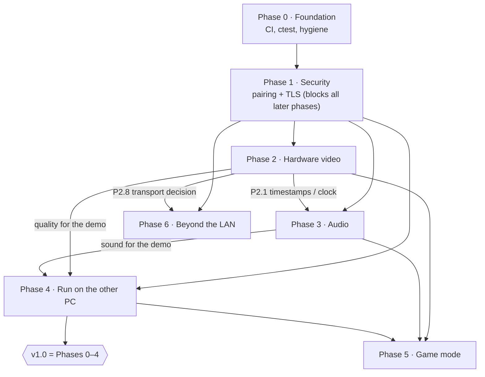

# Sarke roadmap: from hackathon demo to product

> **Vision:** all your devices become one computer you can sit at from anywhere.
>
> **Killer demo:** a weak laptop launches a heavy app or game that runs on the desktop's GPU, and it plays on the laptop with sound.

This plan was written on 2026-10-20 from commit `aa32eb1` (Sarke 1.1.0). Nothing below is implemented unless its box is ticked. Phases further away get less detail on purpose: they are re-planned once the earlier phases have produced real measurements.

**Sizes:**
- **S:** a part of one session.
- **M:** one full session.
- **L:** too big for one session. Split it into S/M tasks before starting it; no L task is started as-is.

**How tasks work:**
- Every task is one branch, `phaseN/<task>`, e.g. `phase0/ci`.
- A task is only done when the [working rules](#working-rules) are met.
- Tick a task (`[x]`) in this file in the same branch that finishes it.

**Contents:**
1. [Decisions needed from you](#decisions-needed-from-you)
2. [Where Sarke is today](#where-sarke-is-today-verified)
3. [Dependency graph](#dependency-graph)
4. Phases: [0 Foundation](#phase-0--foundation), [1 Security](#phase-1--security), [2 Hardware video](#phase-2--hardware-video), [3 Audio](#phase-3--audio), [4 Run on the other PC](#phase-4--run-on-the-other-pc), [5 Game mode](#phase-5--game-mode), [6 Beyond the LAN](#phase-6--beyond-the-lan), [Later](#later-list-only)
5. [v1.0 definition of done](#v10-definition-of-done)
6. [Regression checklist](#regression-checklist)
7. [Working rules](#working-rules)
8. [New dependencies and licenses](#new-dependencies-and-licenses)
9. [Sources](#sources)

---

## Decisions needed from you

They are ordered by when they block work.

**Status (2026-10-20, answered by Demetre):**

| # | Decision | Answer |
|---|---|---|
| D1 | License | **Apache-2.0.** All four authors agree; the project is open source. |
| D2 | Old team | **(a)** Demetre maintains Sarke; Luka, Temo and Sandro consented to the license. |
| D3 | Code signing | **SignPath Foundation.** The repo is public, and Apache-2.0 is an OSI license. Applying is a step for Demetre (P1.13). |
| D4 | Committed binaries | **(a)** Delete them from the tree only; the history is not rewritten. |
| D5 | Releases | **GitHub Releases** is the source of truth, **and** every release is also uploaded to the website ([tools/publish_release.ps1](../tools/publish_release.ps1) stays). |
| D6 | TLS library | **OpenSSL 3.** |
| D7 | Pairing | **(a)** The same 6-digit code on both screens; confirm on both. |
| D8 | Audio on Windows 10 | Open: decided after the P3.1 prototype. |
| D9 | Controllers | Open: decided before Phase 5. |
| D10 | Internet server cost | Open: decided before Phase 6. |

The options below are kept as a record of what was weighed.

### D1. License (needed before P0.8)
Sarke has no LICENSE file today, so it is legally "all rights reserved". Each of the four authors owns the copyright in their own commits: Luka 40, Temo 40, Sandro 21, Demetre 16 (117 in total). Any license needs their agreement (see D2).

| Option | What it means |
|---|---|
| **Apache-2.0** (recommended if open) | Permissive, with an explicit patent grant. Anyone may build on it, including closed products. Compatible with every dependency planned here. Qualifies for free open-source code signing (D3). |
| MIT | The same, but shorter and with no patent grant. |
| GPL-3.0 | Forks must stay open. It is the only option here that lets us reuse code from Sunshine or Moonlight (both GPL-3.0). A closed or paid edition later would need every contributor to agree to relicense. |
| Stay closed / source-available (e.g. PolyForm Noncommercial) | Only if Sarke is meant to be a paid product. The repo should then stay private. |

### D2. Is the old team still involved? (needed before P0.6)
This decides several things:
- whether CLAUDE.md keeps per-person file ownership ("`protocol.h` only in Luka's session");
- who reviews PRs;
- whose consent D1 needs.

| Option | Effect |
|---|---|
| **(a) Demetre maintains it alone; the others only consent to the license** (planning assumption until you answer) | The ownership rules are removed; reviews are your own. |
| (b) The team continues | Roles are kept and Luka reviews; branches follow this roadmap. |
| (c) Open to outside contributors | Adds `CONTRIBUTING.md` and DCO sign-off. |

### D3. Code signing (needed before the v1.0 release; does not block development)
Today the programs are unsigned. The installer even offers a Defender exclusion, because "Defender may flag its unsigned programs by mistake" ([installer/sarke.iss:46](../installer/sarke.iss#L46)).

Costs below were researched in October 2026; check them before buying.

| Option | Cost | Notes |
|---|---|---|
| **SignPath Foundation** (recommended if D1 is open source) | Free for qualifying OSS | The VDD driver we ship is already signed this way. Needs an OSI license and a public repo; signing runs from CI. |
| Azure Artifact Signing (formerly Trusted Signing) | $9.99/month Basic, $99.99/month Premium | Individual sign-up was limited to the USA and Canada. An organisation needs a verifiable business history. |
| OV certificate from a commercial CA | Varies by CA; get quotes | The key must sit on a hardware token or HSM. SmartScreen reputation builds up slowly. |
| EV certificate | More than OV | It no longer gives instant SmartScreen reputation, so it's not worth the extra cost for us. |
| None | $0 | Users keep seeing "Unknown publisher" warnings, and Defender false positives remain. |

### D4. Committed binaries: delete from the tree, or purge history? (needed before P0.5)
In git today:
- `releases/SarkeSetup-1.1.0.0.exe` (4.8 MB);
- `installer/vdd/` (MttVDD driver 11.30.4.434, 280 KB).

| Option | Effect |
|---|---|
| **(a) Delete from the tree only** (recommended) | Nothing breaks; the history keeps about 5 MB. |
| (b) Also purge history with `git filter-repo` | Every commit hash changes, every clone must re-clone, and open branches break. |

### D5. Where releases live (needed before P0.5)
**Recommended:** GitHub Releases is the source of truth (CI uploads to it). The website's download button links to "latest". [tools/publish_release.ps1](../tools/publish_release.ps1), which uploads to Supabase, is retired unless Sandro's site needs it.

### D6. TLS library (confirm before P1.2)

| Option | Notes |
|---|---|
| **OpenSSL 3** (Apache-2.0, vcpkg `openssl`; recommended) | TLS 1.3 on Windows 10 and 11. Easy self-signed-certificate pinning. Has the keying-material exporter that pairing needs. |
| Schannel (built into Windows) | No new dependency, but it has no TLS 1.3 on Windows 10, only on 11 and Server 2022. Pinning and exporters are clumsier. |
| mbedTLS (Apache-2.0) | Smaller, but its TLS 1.3 support is younger and fewer people use it this way. |

### D7. How pairing is confirmed (needed before P1.6)

| Option | Notes |
|---|---|
| **(a) Both screens show the same 6-digit code and the user confirms on both** (recommended) | Nothing to type, and it detects a man-in-the-middle. Bluetooth numeric comparison works the same way. |
| (b) One PC shows a code; you type it on the other | |

### D8. Minimum Windows version for per-app audio (after the P3.1 prototype)
Microsoft documents per-process loopback capture for build 20348 and later. That is Windows 11 / Server 2022, not Windows 10 19041–19045, which this PC runs. If the prototype fails on Windows 10, choose one:
- whole-PC audio on Windows 10 and per-app audio on Windows 11;
- audio on Windows 11 only.

### D9. Game controllers (before P5.3)
ViGEmBus, the usual virtual-gamepad driver, was archived as end-of-life on 2023-11-02 and has no successor.

| Option | Notes |
|---|---|
| (a) Keyboard and mouse only in game mode for now | |
| (b) ViGEmBus, optional and installed by the user | BSD-3-Clause, but frozen. |
| (c) Our own virtual HID driver | Needs kernel-driver attestation signing, which ties back to D3. |

### D10. Internet relay server and its cost (before Phase 6)

| Option | Notes |
|---|---|
| (a) No server | LAN only; for remote access the user runs their own VPN (e.g. Tailscale). |
| (b) Self-hosted | A small VPS runs our signalling service and coturn as the TURN relay. Monthly VPS cost plus relay bandwidth. |
| (c) Managed TURN | Billed per GB relayed. |

---

## Where Sarke is today (verified)

### What I ran (2026-10-20, this PC)
**Machine:** Intel Celeron N4020, Intel UHD Graphics 600, Windows 10 Pro 19045. This is "weak laptop" class hardware.

- **Build** (`cmake --preset x64-release`, `cmake --build --preset x64-release` at `aa32eb1`): exit 0, 113 steps, **0 compiler warnings** at `/W4` ([CMakeLists.txt:15](../CMakeLists.txt#L15)).
- **Headless tests:** all passed with exit 0:
  - `protocol_test`, `queue_test`, `layout_sync_test`, `display_layout_test`, `launcher_test`;
  - `dpi_test`, `video_test`, `video_sender_test`, `file_transfer_test`.
- **`jpeg_test`** (a benchmark, synthetic 1920×1080 frame, 100 runs): avg **21.5 ms**, p95 **35.0 ms**, 515 KB per frame. That is above its own 15 ms target on this CPU; an earlier run gave a 19.1 ms average.
- **Not run today:**
  - tests that need an interactive desktop (hooks, SendInput, clipboard, OLE drag) or the VDD driver;
  - anything that needs two PCs.

  Two-PC features were tested by the team during the hackathon (Oct 17–18), according to the commit history. I have not re-verified them.

### What 1.1.0 does (from the code)
- **KVM both ways:** edge crossing, takeover rules, Ctrl+Alt+Shift+Q emergency key. Uses LL hooks, Raw Input and SendInput.
- **Clipboard both ways:** text, images (PNG) and files (CF_HDROP names, then the file channel).
- **Files:** dragged across the edge or sent with Ctrl+Alt+Shift+F, on TCP 50502, into `Downloads\KVM`.
- **Window viewer:** Ctrl+Alt+Shift+W, with input back to the owner.
- **Desk mode:** the other PC acts as one more monitor through the VDD.
- **Discovery:** UDP 50503, the tray "Connect to ▸" list, and auto-connect.
- **Display arrangement:** kept in sync across both PCs, with Identify.
- **Distribution:** Inno Setup installer and the `sarke.exe` launcher.

### The outside review, checked against the code

| # | Finding | Verdict | Evidence | Fixed in |
|---|---|---|---|---|
| 1 | No authentication | **Confirmed** | `handshake()` only compares `protocol_version` ([host_a/main.cpp:183-200](../host_a/main.cpp#L183-L200)). `listen_on` binds `INADDR_ANY` ([common/src/net.cpp:119-131](../common/src/net.cpp#L119-L131)). Anyone on the subnet who sends `hello` can inject input, which amounts to full control of the PC. | P1.5 |
| 2 | No encryption | **Confirmed** | Keystrokes (passwords included), clipboard, files and video all travel as plain JSON or JPEG over TCP. | P1.5, P1.7 |
| 3 | Auto-connect trusts a name | **Confirmed, and worse** | `auto_listed(d.host.name)` matches the name in a UDP reply ([client_b/launcher.cpp:541-552](../client_b/launcher.cpp#L541-L552)). Because KVM works both ways, a fake host with that name is connected to automatically and can then control the client PC. | P1.8 |
| 4 | Firewall `profile=any`; autostart and Defender exclusion on by default | **Confirmed, with a correction** | The rules are `profile=any` **with** `remoteip=localsubnet` ([installer/sarke.iss:77-80](../installer/sarke.iss#L77-L80)). So it's not the internet, but on public Wi-Fi (café, campus) everyone on the subnet can connect. There are also two program-wide rules (any port). The autostart and Defender tasks have no `unchecked` flag, so they are on by default ([installer/sarke.iss:44-46](../installer/sarke.iss#L44-L46)). | P1.11 |
| 5 | Tests are standalone exes, no ctest or CI, many need two PCs | **Confirmed, with a correction** | There are 26 `*_test.cpp` programs and none needs two PCs. 10 are headless. 7 need an interactive desktop: `win32_input`, `input_capture`, `input_inject`, `kvm_link`, `clipboard`, `file_drop`, `file_drag`. 7 need the VDD driver: `vdd`, `window_mover`, `window_share`, `capture`, `desk`, `desk_hook`, `remote_input`. 2 are hands-on: `kvm_local_test`, `viewer_test`. **What is missing is any automated test of the two-PC paths.** There is no `enable_testing`/`add_test` ([tools/CMakeLists.txt](../tools/CMakeLists.txt)) and no `.github/`. | P0.2, P0.3, P0.7 |
| 6 | Video is CPU JPEG | **Confirmed** | WGC, then a staging-texture copy to the CPU ([host_a/capture.cpp:172](../host_a/capture.cpp#L172)), then TurboJPEG ([host_a/jpeg_encoder.cpp:14](../host_a/jpeg_encoder.cpp#L14)), then TCP. In desk mode: one WGC capture per window ([host_a/desk_share.cpp:136](../host_a/desk_share.cpp#L136)), alpha runs ([host_a/desk_share.cpp:23](../host_a/desk_share.cpp#L23)), CPU decode, `apply_alpha`, CPU compose, and `UpdateLayeredWindowIndirect` ([client_b/desk_view.cpp:66](../client_b/desk_view.cpp#L66), [:411](../client_b/desk_view.cpp#L411)). The viewer uses D2D `CopyFromMemory` ([client_b/viewer_window.cpp:614](../client_b/viewer_window.cpp#L614)). | Phase 2 |
| 7 | Binaries committed | **Confirmed** | `releases/SarkeSetup-1.1.0.0.exe` (4.8 MB) and `installer/vdd/MttVDD.dll`, `.cat` and `.inf`. The README links to the exe in the repo ([README.md:39](../README.md#L39)). | P0.5 |
| 8 | `_tmp` UI files | **Corrected** | They are not leftovers. `client_b/ui_draw_tmp.*` and `ui_tokens_tmp.h` are the **only** UI toolkit, and 11 files include them. They should be renamed, not deleted. | P0.1 |
| 9 | Unknown author | **Confirmed** | 2 commits by `unknown <temomeshveliani777@gmail.com>`, which is Temo. `.mailmap` fixes this without rewriting history. | P0.1 |
| 10 | No LICENSE | **Confirmed** | Only the VDD's license is in the repo (`installer/vdd/LICENSE.txt`). | D1, P0.8 |
| 11 | Hackathon team rules in CLAUDE.md and PLAN.md | **Confirmed** | CLAUDE.md has Georgian team rules and per-person file ownership. `docs/PLAN.md` has the team checklists; `ARTEFACT/` has 12 Georgian hand-off notes. | P0.6 |

### Not in the review, found while checking

| # | Finding | Evidence | Fixed in |
|---|---|---|---|
| A | The video (50501) and file (50502) ports accept anyone at any time, even with no control session. The newest connection **replaces** the current one, so anyone on the subnet can take over the video stream or push files into `Downloads\KVM`. Path traversal is blocked by `safe_destination`, which is good. | `accept_video_loop` ([host_a/main.cpp:111-119](../host_a/main.cpp#L111-L119)) and `file_acceptor` ([:429-433](../host_a/main.cpp#L429-L433)) run for the whole life of the process. | P1.7 |
| B | Discovery tells anyone on the subnet the PC's name and whether it is busy. | [common/src/discovery.cpp:129](../common/src/discovery.cpp#L129) | P1.8 (the reply becomes an identity hint, and nothing in it is trusted) |
| C | `Connection` starts its receive and ping threads in its constructor, before the app has decided whether it trusts the peer. TLS must sit underneath, before these threads start. | [common/src/net.cpp:244-248](../common/src/net.cpp#L244-L248) | P1.5 |
| D | On a version mismatch the host only logs and drops the connection; the user sees nothing. | [host_a/main.cpp:194-197](../host_a/main.cpp#L194-L197), [client_b/main.cpp:196-198](../client_b/main.cpp#L196-L198) | P1.10 |
| E | GitHub-hosted runners may not be able to run hook or SendInput tests (no interactive desktop). This is unverified; P0.3 checks it. | [sep.com article](#sources) | P0.3 |
| F | `/W4` is already warning-free, so turning on `/WX` should cost nothing today. | the build above | P0.4 |

### Numbers we already have
These are from hackathon commit messages and `docs/PLAN.md`; they were not re-measured.
- **Temo's laptop:**
  - JPEG encode 4.2–5.3 ms at 1080p;
  - WGC to consumer ≤ 8 ms;
  - capture at 59–64 fps;
  - capture to B about 25 ms over loopback.
- **Sandro:** JPEG decode about 7 ms at 1080p.
- **Phone hotspot:** RTT 11–591 ms.

Phase 2 starts by measuring its own baseline (P2.1); none of these numbers are used to decide anything.

---

## Dependency graph



The same thing as text:

```
P0 ──► P1 ──┬──► P2 ──┬──► P3 ──► P4 ══► v1.0 ──► P5
            │         └──────────────┘            ▲
            │         (P2 also feeds P5 and P6)   │
            └──────────────────────────────► P6   (P5 needs P2+P3+P4)
```

Task-level links that matter:
- P0.2 (ctest) → P0.3 (CI). From then on, every task must keep CI green.
- P0.7 (loopback harness) → the acceptance tests of P1.5–P1.10.
- P1.4 (paired-device store) → P4.1 (per-device permissions).
- P2.1 (latency HUD and clock) → every Phase 2 decision, and P3.5 (A/V sync).
- The recommended order after Phase 1 is P2 → P3 → P4, because the killer demo needs all three. P4.1–P4.4 also work over JPEG and can move ahead if Phase 2 stalls.

---

## Phase 0 · Foundation

**Goal:** make the repo a place where a product can be built safely: CI that builds and tests every push, tests that run themselves, no binaries in git, and rules for one maintainer instead of a hackathon team.

**Current state:**
- Builds cleanly at `/W4` (see above).
- Sources are globbed by `kvm_add_module_lib` ([CMakeLists.txt](../CMakeLists.txt)), and every `tools/*.cpp` becomes an exe ([tools/CMakeLists.txt](../tools/CMakeLists.txt)).
- No `enable_testing`, no `.github/`, no `.clang-format`, no LICENSE.
- vcpkg manifest with a `builtin-baseline` ([vcpkg.json](../vcpkg.json)).

### Tasks

- [x] **P0.1 Hygiene: `.mailmap` and renaming the `_tmp` UI files** (S), branch `phase0/hygiene`.
  - **Files:**
    - new `.mailmap` (maps `unknown <temomeshveliani777@gmail.com>` to Temo Meshveliani);
    - `git mv client_b/ui_draw_tmp.{h,cpp}` → `ui_draw.{h,cpp}`, and `ui_tokens_tmp.h` → `ui_tokens.h`;
    - update the 11 `#include`s.
  - No CMake change is needed (glob).
  - **Done when:**
    - build passes;
    - `git shortlog -sne` shows no `unknown`;
    - the `ui_preview_*` tools still run (manual, one PC).

- [x] **P0.2 Turn the tests into ctest, with labels** (M), branch `phase0/ctest`.
  - **Files:**
    - root `CMakeLists.txt`: `enable_testing()`;
    - `tools/CMakeLists.txt`: `add_test` for every `*_test`, with `TIMEOUT` and `LABELS`;
    - `CMakePresets.json`: `testPresets`.
  - **Labels:**
    - `unit`: headless, safe for CI. The 9 that passed above.
    - `bench`: `jpeg_test` (always exits 0; prints timings).
    - `desktop`: needs an unlocked interactive session.
    - `vdd`: needs the VDD driver installed.
    - `manual`: `kvm_local_test`, `viewer_test`. Not registered, only listed in the docs.
    - `loopback`: added in P0.7.
  - **Presets:**
    - `ctest --preset unit`;
    - `ctest --preset local` (unit + desktop + vdd + loopback, on a dev PC).
  - **Done when:**
    - `ctest --preset unit` passes on this PC;
    - `ctest --preset local` passes at an unlocked desktop, or each failure is written up here as a known issue.
  - **Result (2026-10-20, this PC):**
    - **`unit`:** 9/9 pass in about 13 s.
    - **`local`:** 25 tests including the Paint fixture, about 2.5 min.
    - **A configure guard** fails the build when a `*_test.cpp` is in no group.
    - **Three test fixes**, test code only:
      - `vdd_test` expected 1920×1200 to fall back to 1080p, but 1920×1200 has been a shipped VDD mode since `f1e2d8f`;
      - `video_sender_test`'s fixed 20 fps floor was beyond a Celeron's reach (18.6–21 fps), so the floor now follows the encode time measured on the machine. It also failed whenever other work was using the CPU (6–11 fps while a type-check ran in another project), so the floor is now a hard check only with `SARKE_STRICT_TIMING=1`, which CI sets; on a dev PC a low number is logged as `[slow]`;
      - `desk_test` now gets `--settle 3`.
    - **Known issue, since fixed by P0.9:** `window_mover_test` and `capture_test` failed now and then in the full sequence but passed on their own.

- [x] **P0.3 GitHub Actions CI** (M), branch `phase0/ci`. Depends on P0.2.
  - **Files:** `.github/workflows/ci.yml`.
  - **Steps:**
    1. Run on `windows-latest`.
    2. Set up MSVC with `vswhere` and `vcvars64` in a script step, so no third-party action is needed.
    3. Clone vcpkg at the manifest's `builtin-baseline`.
    4. Configure and build the `x64-release` preset.
    5. Run `ctest --preset unit`.
    6. Upload the exes as an artifact.
  - **Binary cache:** vcpkg's `x-gha` provider was removed in vcpkg 2025.06.13. Use `actions/cache` on a `files` binary cache directory, keyed on `vcpkg.json`, the baseline and the triplet. NuGet on GitHub Packages is the alternative.
  - **One-off probe:** run `win32_input_test` on the hosted runner and write down whether hooks and SendInput work there. If they do, add `desktop` to CI; if not, record that they stay local.
  - **Done when:**
    - the PR shows a green run;
    - cold and warm build times are written here (measured, not guessed).
  - **Result (2026-10-20, image `windows-latest` 20261018.275.1):**
    - **Timings:**
      - cold run 437 s;
      - second run 438 s, with the vcpkg cache restored (8.2 MB entry);
      - "configure, build, unit tests" takes about 360 s, nearly all of it compiling Sarke itself.

      The cache will matter once OpenSSL arrives (P1.2).
    - **Desktop probe:** all 7 `desktop` tests passed on the hosted runner in both runs (no failure annotation). They stay a non-required step until 5 runs in a row have passed; then they move into the required step.
    - **Action versions:** checkout v7, cache v6 and upload-artifact v7. The v4 actions ran on Node 20, which is deprecated.

- [x] **P0.4 `/WX` and clang-format** (M), branch `phase0/format`.
  - **Files:**
    - root `CMakeLists.txt`: add `/WX`, and `/external:anglebrackets /external:W0` so vcpkg headers don't fail the build;
    - `.clang-format` derived from the current style (4-space indent, ~120 columns; check it against existing files);
    - `.editorconfig`.
  - **Mechanics:**
    - One format-only commit, recorded in `.git-blame-ignore-revs`.
    - CI step: `clang-format --dry-run --Werror` on changed files, using the clang-format that ships with VS or LLVM on the runner.
  - **Done when:**
    - CI fails on a deliberately added warning or a badly formatted line (test this in the PR, then revert it);
    - a clean build passes.
  - **Result (2026-10-20):**
    - **Options:** chosen by formatting a copy of the tree with 8 variants. The winner changes the fewest lines (2,928, about 10%): Google style, 4-space indent, 120 columns, short functions only inline, one-line `case` labels, unindented cases, includes never reordered.
    - **Format-only commit:** `05371f0` (81 files), listed in `.git-blame-ignore-revs`. Split string literals stay one string at compile time, so the log lines the launcher parses don't change.
    - **`/WX` on, plus `/external:anglebrackets /external:W0`:** the full rebuild has 0 warnings and 9/9 unit tests pass. The resource compiler accepts the flags.
    - **CI** runs a clang-format 19.1.5 check (the same version VS 2022 ships, pinned from PyPI) before the build.
    - **Not re-run:** the `local` suite. This change can't alter behaviour (formatting and compiler flags only).
    - **Negative test** on a throwaway branch (since deleted):
      - a correctly formatted unused variable failed CI's build step (`/WX`);
      - a badly formatted line failed CI's format step after 30 s, before the build.

- [ ] **P0.5 Binaries out of git; VDD fetch script; GitHub Releases** (M), branch `phase0/releases`. Depends on D4 and D5.
  - **Files:**
    - `git rm releases/SarkeSetup-1.1.0.0.exe` and `installer/vdd/{MttVDD.dll,MttVDD.cat,mttvdd.inf}`;
    - `.gitignore` entries;
    - new `tools/fetch_vdd.ps1`:
      - downloads the pinned VDD release from its upstream GitHub;
      - **verifies a SHA-256 pinned in the script**;
      - unpacks into `installer/vdd/`;
    - `tools/make_installer.ps1` calls it;
    - `README.md` links to GitHub Releases.
  - **Release:** publish `v1.1.0` as a GitHub Release with the existing installer attached. Optionally, a `release.yml` workflow builds the installer on a tag; it needs Inno Setup on the runner.
  - **License files (from P0.8):** `installer/sarke.iss` copies `LICENSE`, `NOTICE` and `THIRD_PARTY_NOTICES.md` into `{app}\licenses`, next to the VDD license.
  - **Website (D5):** the same installer is also uploaded to the website with [tools/publish_release.ps1](../tools/publish_release.ps1). Document the two-step release (GitHub Release, then website) in `docs/RELEASING.md`.
  - **Done when:**
    - a fresh clone + `fetch_vdd.ps1` + `make_installer.ps1` produces an installer that works in Windows Sandbox;
    - a wrong hash makes the script fail.
  - **Result so far (2026-10-20):**
    - **Removed from git:** `releases/` and the VDD binaries. The website already downloads from Supabase, so nothing links to them.
    - **`fetch_vdd.ps1`:** pins release 25.7.23 and checks the zip hash plus three file hashes. Its four checks pass:
      - present → no download;
      - missing → downloaded and verified;
      - wrong zip hash → refused, nothing written;
      - a corrupted file → downloaded again.
    - **Fresh clone of the branch + `fetch_vdd.ps1` + ISCC:** builds the installer, which packs the driver, `LICENSE`, `NOTICE` and `THIRD_PARTY_NOTICES.md`.
    - **`make_installer.ps1`:** passes end to end, and now only closes a Sarke started from the repo's build, never an installed one.
    - **Inno Setup:** 6.7.3 installed per-user on this PC (signed by Pyrsys B.V.).
    - **Tag:** `v1.1.0` on `356dacf`, pushed.
    - **Remaining:**
      1. ~~Create the GitHub Release `v1.1.0`~~: done 2026-10-20 through the API. The asset `SarkeSetup-1.1.0.0.exe` downloaded from `releases/latest` has SHA-256 `5a38cefd…`, the same as the original.
      2. **Install test in Windows Sandbox:** Sandbox isn't enabled on this PC. Enabling it needs admin and a reboot; alternatively, a spare PC.

- [x] **P0.6 Rewrite CLAUDE.md; archive the hackathon docs** (S), branch `phase0/claude-md`. Depends on D2.
  - **New CLAUDE.md** (English):
    - the product, the architecture map, build/test commands, ctest labels;
    - the one-machine loopback recipe;
    - the [working rules](#working-rules) from this file;
    - the security rules from Phase 1, once they exist.
  - **Moves:**
    - the protocol table goes to a new `docs/PROTOCOL.md`;
    - `docs/PLAN.md`, `docs/BLUEPRINT.md` and `ARTEFACT/` go to `docs/archive/hackathon/`, unchanged and kept for history;
    - `protocol.h` loses its "frozen team contract" comment.
  - **Done when:**
    - no team-ownership rules remain (if D2 = a);
    - every link in README and CLAUDE.md resolves.
  - **Result (2026-10-20):**
    - **New `CLAUDE.md`:** session start, the working rules, build and test (labels, strict timing), loopback recipe, map, the rules the code depends on, security, releasing.
    - **New `docs/PROTOCOL.md`:** the old Georgian table in English, checked against `protocol.h`. It adds clipboard kind `files`, which the old table missed.
    - **Archived** to `docs/archive/hackathon/` with a README, all unchanged: `PLAN.md`, `BLUEPRINT.md`, `ARTEFACT/` and the old `CLAUDE.md`.
    - **References fixed:** README, DESIGN, two code comments and `vdd_test`'s error message now point at the new places. `protocol.h` no longer says "frozen team contract".
    - **Links:** every relative link in the edited docs resolves; a link checker was run over them.
    - **Later (2026-10-20, Demetre's request):** `CLAUDE.md` is no longer published. It stays local and ignored, and the working rules moved to a public [CONTRIBUTING.md](../CONTRIBUTING.md).

- [x] **P0.7 Loopback harness for the two-PC paths** (M), branch `phase0/loopback-harness`.
  - **Files:**
    - new `tools/loopback_smoke_test.cpp`, label `loopback`. It:
      - starts `kvm_host.exe --no-kvm` and `kvm_client.exe --host 127.0.0.1 --no-kvm --desk-no-vdd`, each with its own `--config` in a temp folder;
      - waits for `connected` and `link: rtt` in both logs;
      - stops both cleanly and checks the exit codes.
    - `tools/kvm_fake_peer.cpp` becomes scriptable: `--expect <type>`, `--send <json>`, exit code = the result.
  - This is the base for the Phase 1 acceptance tests (an unpaired peer is rejected, and so on).
  - **Done when:**
    - `ctest -L loopback` passes on this PC;
    - if `--no-kvm` is enough for the hosted runner, it is added to CI.
  - **Result (2026-10-20):**
    - **`tools/loopback_test.cpp`** (label `loopback`): starts the real `kvm_host` and `kvm_client` on ports Windows picks, each with its own config in a temp folder, with `--no-kvm --no-clipboard --no-desk`. It checks:
      1. a peer speaking another protocol version is dropped, and the host logs the mismatch;
      2. a peer speaking this version gets the host's `hello`;
      3. the client connects on all three channels and both sides log `link: rtt`;
      4. Ctrl+Break (the launcher's way of stopping them) ends both with exit code 0.

      15 checks pass, in about 9 s.
    - **New `kvm_host --no-discovery`**, so a test host is never listed on the network.
    - **The peer in checks 1–2 is in-process** (`kvm::net::connect`) rather than a scriptable `kvm_fake_peer`. That's simpler, and TLS in P1.5 changes that code anyway.
    - **New `ci` preset** (unit + loopback), which CI now runs; `local` includes loopback too.
    - **`video_test` used a fixed port, 50599.** On this PC Windows reserves TCP 50503–50602 (`netsh interface ipv4 show excludedportrange protocol=tcp`; Hyper-V, WSL and Docker do this), so the test now uses a port Windows picks. The same risk for Sarke's own ports is P0.10.

- [x] **P0.8 License** (S), branch `phase0/license`. D1 = Apache-2.0, and all four authors agree.
  - **Files:**
    - `LICENSE` (Apache-2.0 text) and `NOTICE`;
    - an `SPDX-License-Identifier` line at the top of each source file (scripted);
    - `README.md` credits and license section;
    - `THIRD_PARTY_NOTICES.md` (nlohmann-json MIT, libjpeg-turbo BSD-3/IJG/zlib, VDD MIT, and later additions).
  - **Done when:**
    - GitHub detects the license;
    - the notices list every vcpkg dependency.
  - **Result (2026-10-20):**
    - **Files:** `LICENSE` (the canonical Apache-2.0 text, SHA-256 `cfc7749b…`), `NOTICE`, `AUTHORS`, and `"license": "Apache-2.0"` in `vcpkg.json`.
    - **SPDX:** an SPDX line at the top of all 141 C++/RC source files.
    - **Notices:** `THIRD_PARTY_NOTICES.md` holds the full license texts. The check found that **libspng 0.7.4 and zlib 1.3.2** are compiled into the exes through libjpeg-turbo (their strings are in `kvm_host.exe`), so they are listed too.
    - **Moved to P0.5:** shipping `LICENSE`, `NOTICE` and `THIRD_PARTY_NOTICES.md` in the installer's `licenses` folder. Inno Setup isn't on this PC, so the installer change can't be verified here.

- [x] **P0.9 Window moves right after the VDD attaches** (S/M), branch `phase0/window-mover-race`. Found by P0.2.
  - **Symptom:** `WindowMover::send` sometimes logs "the window did not end up maximized on the target monitor" ([host_a/window_mover.cpp:116](../host_a/window_mover.cpp#L116)) when the VDD was attached a moment earlier. It shows up as intermittent `window_mover_test`/`capture_test` failures in `ctest --preset local`; both pass when run alone.
  - **Suspect:** Windows re-places windows after a display-topology change, after `wait_until_settled` has already returned. That would also hit the window viewer's Ctrl+Alt+Shift+W in real use.
  - **Plan:**
    1. Reproduce it in a loop (`ctest -R "window_mover|capture" --repeat until-fail:20`).
    2. Log the window rect over time after the attach.
    3. Then fix `send` (wait for the topology change to settle, or verify and retry once), plus a regression check in `window_mover_test`.
  - **Done when:** 20 runs of `ctest --preset local` in a row have no window-move failures.
  - **Result (2026-10-20):**
    - **Reproduced** with a log of where the window ended up: 1 failure in 20 moves (10 rounds of `vdd_test` → `window_mover_test` → `capture_test`). The window was maximized **on the primary monitor**, not the VDD, and it stayed there 1 s later. So it had been put back on its old monitor before `SW_MAXIMIZE`: Windows re-places windows for the new display layout right after the VDD attaches.
    - **Fix** ([host_a/window_mover.cpp](../host_a/window_mover.cpp)): check the monitor before and after maximizing, and on a miss un-maximize, wait 300 ms and move again (3 attempts). Each miss is logged with the window's position.
    - **Verified:**
      - 20 rounds of `vdd_test`, `window_mover_test`, `capture_test` and `window_share_test`: 120/120 pass;
      - the log shows 4 "moved back before maximizing", each fixed by the second attempt;
      - `ctest --preset local` 27/27.

      Not run: 20 *full* `local` runs, which take about an hour. The rounds cover every test that moves a window onto the VDD.

- [x] **P0.10 Sarke's ports reserved by Windows** (S), branch `phase0/reserved-ports`. Found by P0.7.
  - **Problem:** Hyper-V, WSL and Docker reserve TCP port ranges (`netsh interface ipv4 show excludedportrange protocol=tcp`), and the ranges can change on reboot. If one covers 50500–50502, `kvm_host` can't listen (WSAEACCES, 10013). On this PC 50503–50602 is reserved, one port above Sarke's.
  - **Plan:**
    - on WSAEACCES, log and show in the launcher which port is reserved, and how to free it or pick others (`control_port`/`video_port`/`file_port` in config.json);
    - discovery already carries `control_port`, so the client follows a moved control port. Check that the video and file ports follow too (today the client takes them from its own config).
  - **Done when:** a test that reserves a port first sees the clear message, and a host on custom ports is found and fully connected through discovery.
  - **Result (2026-10-20):**
    - **`listen_on` now explains a port it can't take** ([common/src/net.cpp](../common/src/net.cpp)):
      - if a program listens there (`GetExtendedTcpTable`), the message names it, e.g. "in use by kvm_host.exe (pid 8976)";
      - if nothing listens and Windows refuses it, the message says Windows reserved it, gives the `netsh` command, and points at the config.json ports.

      The launcher already shows `[error]` lines as a "Sarke has a problem" toast.
    - **New `net_listen_test`** (unit):
      - a held port → the holder is named;
      - `--reserved 50599` on this PC → "Windows reserved it".

      Also checked end to end: `kvm_host` configured with port 50599 logs the reserved message.
    - **Plan change:** "the client follows the host's video/file ports" moved into **P1.7**. Today the client opens the side channels before the host's `hello` arrives, and P1.7 restructures that anyway (side channels after the authenticated handshake, with a session token). Until then, custom ports must match on both PCs; the README says so. *(Done in P1.7.)*

### Phase 0 acceptance
- **Automated:**
  - CI is green on `main`, running `unit`, format and `/WX`;
  - `ctest --preset local` and `-L loopback` pass on the dev PC.
- **Manual:** a fresh clone, the VDD fetch and the installer build work, and the installer passes in Windows Sandbox.

### Risks and unknowns

| Risk | Plan |
|---|---|
| Hosted runners may lack an interactive desktop for hook tests | P0.3 probes it. If so, `desktop` stays local, and a self-hosted runner can be considered later. |
| Cold vcpkg builds get slow once OpenSSL arrives | The cache from P0.3; record the timings. |
| The one-time format commit conflicts with teammates' open branches | Only matters if D2 = b; merge their branches first. |

---

## Phase 1 · Security

**Goal:** only devices the user has paired can connect, and everything between them is encrypted and authenticated.

> **Blocks everything after it.** No Phase 2+ work lands on `main` before Phase 1 is merged.

**Current state:**
- **No authentication and no encryption**, on any port.
- Side channels can be hijacked.
- Auto-connect goes by name.
- The firewall is open on public networks.
- See findings 1–4 and A–D [above](#the-outside-review-checked-against-the-code).
- What is already good: frame-size limits (`kMaxControlMessageBytes` 64 KB, `kMaxFramePayloadBytes` 32 MB, [protocol.h:30-31](../common/include/kvm/protocol.h#L30-L31)), and `safe_destination` for file paths ([common/src/file_transfer.cpp:134](../common/src/file_transfer.cpp#L134)).

### Threat model (summary; the full version is written in P1.1 as `docs/SECURITY.md`)

**Assets:**
- control of the PC (input injection is as good as remote code execution);
- keystrokes, including passwords;
- clipboard and files;
- the pixels of shared windows and desk mode;
- the right to write into `Downloads\KVM`.

**Attackers in scope:**
1. **Passive, on the same Wi-Fi or LAN:** reads traffic. The team itself used campus Wi-Fi and a phone hotspot.
2. **Active, on the same network:**
   - connects to 50500–50502;
   - spoofs discovery replies;
   - ARP-spoofs to sit in the middle;
   - takes over the video or file socket.
3. **Someone who owned a paired device once:** after unpairing, they must be locked out.

**Out of scope for v1.0:**
- a fully compromised paired PC (it is trusted to control you, by definition);
- malware already running as the same Windows user;
- traffic analysis (keystroke timing is visible from packet sizes, even under TLS);
- LAN denial of service, which is handled on a best-effort basis by the pre-auth limits.

**Required properties:**

| ID | Property |
|---|---|
| S1 | Mutual authentication, with device keys pinned at pairing. |
| S2 | Confidentiality and integrity on every channel. |
| S3 | **Nothing from an unpaired peer is parsed.** TLS and the key check finish before the first application byte is read. |
| S4 | Side channels are bound to the live control session. |
| S5 | Pairing resists a man-in-the-middle. |
| S6 | Discovery is a hint only; nothing in it is trusted. |
| S7 | The private key is protected at rest (DPAPI, current user). |
| S8 | Unpair takes effect immediately. |
| S9 | Pre-auth limits: handshake timeout, a cap on pending handshakes, backoff per IP. |

### Design (recommended; no hand-rolled crypto)

**Transport**
- **TLS 1.3** via OpenSSL 3 (D6) on all three TCP channels.
- Mutual TLS, TLS 1.3 only, default cipher suites.

**Identity**
- One **ECDSA P-256** keypair per device. P-256 rather than Ed25519, to keep future macOS and phone clients easy.
- A self-signed X.509 certificate.
- **Device ID** = SHA-256 of the certificate's SubjectPublicKeyInfo. It is shown to people as a short fingerprint.
- The private key is encrypted with DPAPI `CryptProtectData` (current user) and stored as `identity.bin` in the config directory (`%LOCALAPPDATA%\Sarke` when installed, [common/src/config.cpp:50](../common/src/config.cpp#L50)).

**Pinning**
- The TLS verify callback accepts any certificate and records its fingerprint.
- Right after the handshake, before any application read, the fingerprint is checked against `paired.json`.
- An unknown key may only enter the **pairing** exchange: no input, clipboard, files or video.

**Pairing (D7 = a)**
1. Both sides derive a 6-digit code from `SSL_export_keying_material` (label `EXPORTER-sarke-pairing`, context = both fingerprints, sorted). This is the RFC 8446 exporter. A man-in-the-middle ends up with different TLS sessions on each side, so the two codes differ.
2. Both PCs show the code. The user confirms on both, within 60 s.
3. Each side stores the other's fingerprint, name and permissions.

Attempts are rate-limited.

**Side channels**
- 50501 and 50502 use TLS with the same certificates.
- The peer's fingerprint must equal the live control session's peer.
- The first frame must carry a 32-byte random `session_token`, which was handed out over the encrypted control channel.
- Acceptors run only while a session is live, and a new connection never replaces a working one from another session.

**Discovery**
- `kvm_here` adds `device_id`. Auto-connect matches `device_id`; the name is only for display.
- A spoofed reply can at most trigger a TLS attempt that fails pinning, and that failure is logged and shown.

**Protocol v3**
- `kProtocolVersion = 3`. Every new message is listed in `docs/PROTOCOL.md`.
- A v2 peer sends plaintext bytes where a TLS ClientHello (`0x16 0x03`) is expected. The server spots this and logs/shows "an older Sarke (v2) at X tried to connect; update both PCs".

### Tasks

- [x] **P1.1 `docs/SECURITY.md`: threat model and design** (S), branch `phase1/threat-model`.
  - The model and design above in full, plus test vectors for the code derivation.
  - **Done when:** you have reviewed it, and D6 and D7 are answered.
  - **Result (2026-10-20):** written as [docs/SECURITY.md](SECURITY.md) and approved by Demetre (PR #3). GitHub private vulnerability reporting is on.

- [x] **P1.2 TLS transport** (M), branch `phase1/tls`.
  - **New dependency:** vcpkg `openssl` (Apache-2.0); why it is needed is in D6.
  - **Files:** new `common/include/kvm/tls.h` and `common/src/tls.cpp`:
    - RAII wrappers for `SSL_CTX` and `SSL`;
    - `TlsStream` over a connected `SOCKET`, with the same blocking `send_all`/`recv_exact` semantics as [socket_util.h](../common/src/socket_util.h);
    - TLS 1.3 only, mutual certificates;
    - a fingerprint accessor and an exporter accessor.
  - **Tests:** new `tools/tls_test.cpp`, label `unit`, over loopback:
    - the handshake works;
    - the fingerprint matches;
    - a plaintext peer is rejected;
    - TLS 1.2 is refused;
    - the exporter is equal on both sides;
    - **a relaying man-in-the-middle with its own key gives different exporters**.
  - **Measure:** exe size growth and the clean CI build time.
  - **Result (2026-10-20):**
    - **OpenSSL 3.6.5** (vcpkg baseline, port 3.6.5#2) is linked statically and privately to `kvm_common`.
    - **[kvm/tls.h](../common/include/kvm/tls.h):**
      - `Credentials`: P-256 key, self-signed certificate, DER in and out, device ID = SHA-256 of the SPKI;
      - `Stream`: TLS 1.3 only, mutual, no tickets, no session cache;
      - one reader plus many writers: a lock around each OpenSSL call, waits in `select()` outside it;
      - `abort()`, the exporter, and `pairing_code()`.
    - **`tls_test` (unit): all checks pass, 10 runs in a row on this PC, and in CI.** It covers:
      - handshake and device IDs;
      - the same exporter bytes on both ends;
      - 1 MB both ways, and full duplex with two writers (600 + 1000 messages, none interleaved);
      - abort and close;
      - refusals: a plaintext peer ("wrong version number", 0 ms), a silent peer (timeout), a TLS 1.2 client ("unsupported protocol"), a client without a certificate ("peer did not return a certificate");
      - a relaying man-in-the-middle: both sides see the relay's key, and the two halves export different codes.
    - **Found and fixed during the work:** `abort()`'s `CancelIoEx` also cancels the I/O request a `select()` is waiting on, so the wait fails. That is now reported as an abort, not a reset.
    - **Measured:**
      - OpenSSL takes 25 min to build on this Celeron; afterwards it comes from the vcpkg binary cache (CI: actions/cache).
      - The cold CI build step went from about 430 s to 805 s, OpenSSL included.
      - `kvm_host.exe` is still 6.71 MB (it doesn't use TLS until P1.5); `tls_test.exe` is 9.44 MB.

- [x] **P1.3 Device identity** (M), branch `phase1/identity`.
  - **Files:** new `common/include/kvm/identity.h` and `common/src/identity.cpp`:
    - generate the P-256 key and the self-signed certificate;
    - DPAPI protect and unprotect;
    - load or create in the config directory.
  - A corrupt `identity.bin` is never silently replaced; the user is told, because a new key means re-pairing.
  - **Tests:** `tools/identity_test.cpp` (unit):
    - creates, reloads and gets the same fingerprint;
    - a tampered blob fails cleanly.
  - **Manual:** the file can't be decrypted as another Windows user.
  - **Result (2026-10-20):**
    - **[kvm/identity.h](../common/include/kvm/identity.h):** `load_or_create()` and `recreate()`, with `identity.bin` always in `%LOCALAPPDATA%\Sarke`, never next to a source build's `config.json`. `.gitignore` excludes `identity.bin*` as a second guard.
    - **Storage:**
      - DPAPI with `CryptProtectData` (current user, no UI, purpose-bound entropy) around `"SRKIDv1"` + the PKCS#8 key + the certificate;
      - decrypted bytes are wiped after use;
      - writes go to a temp file, which then replaces the real one (`MoveFileEx`).
    - **`identity_test` (unit): all checks pass, 5 runs in a row.** It covers:
      - create, then reload with the same ID;
      - the private key isn't in the file in the clear;
      - damaged → CannotDecrypt, decrypts to something else → Corrupt, a folder in its place → Unreadable, and none of them replaced;
      - recreate moves the old file to `identity.bin.broken-<time>`, and the new identity loads after.
    - **Still manual:** that another Windows user can't decrypt the file, which needs two accounts. Not run yet.

- [x] **P1.4 Paired-device store** (S), branch `phase1/paired-store`.
  - **Files:** new `common/include/kvm/paired.h` and `common/src/paired.cpp`.
  - `paired.json` holds `[{device_id, name, paired_at, last_seen, auto_connect, permissions:{}}]`. The `permissions` object is filled in Phase 4.
  - **Migration:** `settings.json` `auto_connect` names are **not** carried over as trust. The first v3 run shows "pair your PCs again".
  - **Tests:** extend `launcher_test`, or add a new `paired_test`.
  - **Result (2026-10-20):**
    - **[kvm/paired.h](../common/include/kvm/paired.h):** `Store` with add (replaces an existing ID, never duplicates), remove, find, all, auto-connect, last seen, and `reload()` for changes from other processes.
    - **Saving:** thread-safe and atomic (a temp file, then a replace).
    - **Fails closed:** an unparseable `paired.json` means no PC is trusted, and the next save keeps it as `paired.json.broken-<time>`. Entries without a valid ID are skipped.
    - **`paired_test` (unit):** 17 checks pass.
    - **The migration message** ("pair your PCs again") belongs to the UI tasks (P1.8, P1.9): `settings.json` names are simply never read as trust.

- [x] **P1.5 TLS + pinning on the control channel (50500)** (M), branch `phase1/control-tls`. Depends on P1.2–P1.4 and P0.7.
  - **Files:**
    - [common/src/net.cpp](../common/src/net.cpp): `Connection` is built from an *authenticated* `TlsStream`; threads start only after the key check (finding C);
    - [host_a/main.cpp](../host_a/main.cpp): `handshake()`;
    - [client_b/main.cpp](../client_b/main.cpp).
  - **Protocol:** v3; `hello` adds `device_id`.
  - Until P1.6 exists, pairing uses a **test-only** `--pair-with <fingerprint>` command line, never a "trust on first use" switch.
  - **Tests** (loopback, built on P0.7):
    - a `kvm_fake_peer` with an unknown key is closed **before any `hello` log line**;
    - plaintext v2 bytes are rejected;
    - a paired peer connects and gets `link: rtt`.
  - **Measure:** `link: rtt` with and without TLS, recorded in `docs/PERF.md`.
  - **Result (2026-10-20):**
    - **`kvm::net`** runs on `tls::Stream`. `Server::accept()` and `connect()` return a `Handshaken` connection (TLS done, nothing read). The new **[kvm/trust.h](../common/include/kvm/trust.h)** checks its key against `paired.json`, and only then does a `Connection` (which starts reading) exist. The TLS stream got a receive timeout (the old 10 s dead-peer rule).
    - **Both programs:**
      - `--data-dir`, `--print-id`, `--pair-with` (until P1.6), `--recreate-identity`;
      - they log their device ID;
      - `hello` carries `device_id`, and `kProtocolVersion` is 3.
    - **`kvm_fake_peer`:** speaks TLS with its own identity in `%TEMP%` and gained `--port`. It was run against a paired host: the session ran and ended normally.
    - **`loopback_test`: 26 checks pass.** They include:
      - each program creates and keeps its identity;
      - an unpaired key is closed right after the handshake, and its `hello` never appears in the host log (S3);
      - a plaintext v2 peer is closed;
      - version mismatch, `hello` v3 with the device ID, then the client on all three channels with rtt, and a clean stop.
    - **Measured** ([PERF.md](PERF.md)): TLS adds about 37 µs to a 64-byte round trip on the Celeron (loopback, median of 2000).
    - **Merge order:** merged together with P1.6. On its own, PCs could only pair with `--pair-with`.

- [x] **P1.6 Pairing flow and code UI** (M), branch `phase1/pairing`. Depends on P1.5 and D7.
  - **Protocol:** `pair_request{name}`, `pair_confirm{ok}`, `pair_result{ok, reason}`.
  - **How the code reaches the user:**
    - `kvm_host`/`kvm_client` print `pairing: code 123 456 with <name>`;
    - `sarke.exe` parses it ([client_b/launcher.cpp](../client_b/launcher.cpp)) and shows a confirm dialog with the `ui_draw` toolkit;
    - the answer goes back on stdin as `pair yes|no`, extending [launcher_commands.h](../common/include/kvm/launcher_commands.h).
  - 60 s timeout; a cancel on either side stores nothing.
  - **Tests:**
    - unit: code derivation against the test vectors;
    - loopback: the test drives both stdins the way the launcher does, and checks paired / cancelled / timed out.
  - **Manual (two PCs):** pair them; the codes match; confirm; restart both and they reconnect without asking.
  - **Result (2026-10-20):**
    - **Protocol:** `pair_request`, `pair_confirm` and `pair_result`.
    - **[kvm/pairing.h](../common/include/kvm/pairing.h):**
      - `run()`: the code comes from the RFC 8446 exporter; the responder accepts only `pair_request` from an unknown key; each side stores the other only when both confirmed;
      - `Prompt`, which is armed before the question is logged, so an instant answer isn't lost;
      - `AttemptLimit`: 3 per IP per 10 minutes.
    - **Host:** a key that isn't paired goes to the pairing responder.
    - **Client:** `--pair-unknown` (the launcher passes it when the user picked the PC) pairs, then reconnects as a paired PC.
    - **Answers:** `pair yes` / `pair no` on stdin. Ctrl+Break cancels a pending question.
    - **Launcher:**
      - `PairingCode` / `PairingDone` events;
      - a TaskDialog ([client_b/pairing_dialog.h](../client_b/pairing_dialog.h)) asking "Does the other PC show 042 917?", with Pair / Cancel (Cancel is the default) and a 55 s countdown that cancels by itself;
      - `pairing_dialog.cpp` declares Common Controls 6 for every program that links it.
      - The dialog was checked by screenshot (`tools/ui_preview_pairing.exe`).
    - **Tests:**
      - `loopback_test`, 35 checks, 3 runs in a row: the two pairing runs show the same code on both sides (`035 856`), confirm → both store and the client reconnects, cancel → nothing stored and nothing connects;
      - `launcher_test`: the pairing log lines;
      - `protocol_test`: the new messages;
      - `ctest --preset ci` 14/14.
    - **Not run yet:** pairing on two physical PCs (R17).

- [x] **P1.7 TLS and session binding on video (50501) and files (50502)** (M), branch `phase1/side-channels`. Depends on P1.5.
  - **Files:**
    - [common/src/video.cpp](../common/src/video.cpp), [common/src/file_transfer.cpp](../common/src/file_transfer.cpp);
    - [host_a/main.cpp:111-119, 429-433](../host_a/main.cpp#L111-L119);
    - the client's connect paths;
    - a shared `SideChannel` helper, also reused for audio in P3.3.
  - **Protocol:** the control channel sends `session_token{token}`; each side channel's first header carries `token`.
  - **From P0.10:** the side channels open after the host's answer, which carries its `video_port` and `file_port`, so ports changed only on the host still work.
  - **Tests** (loopback):
    - a second connection to 50501/50502 with another key, or with the right key and a wrong token, is rejected **and does not replace** the live channel (this is finding A);
    - no session → no side-channel accept.
  - **Measure:** `video_test` throughput with and without TLS, and the end-to-end frame time on this PC (AES-GCM on the N4020), recorded in PERF.md.
  - **Result (2026-10-21):**
    - **Helper ([kvm/net.h](../common/include/kvm/net.h)):**
      - `SessionKey` holds the live session's peer and its 32-byte token (`RAND_bytes`, compared with `CRYPTO_memcmp`);
      - `admit_side_channel()` is the host side; `connect_side_channel()` is the client side, which pins the host's key and sends `channel_hello{token}`;
      - P3.3's audio channel can reuse both.
    - **Video and files:** `FrameChannel`, `FileTransfer` and their servers run on `tls::Stream`. `connect_video` / `connect_files` take the keys and the token.
    - **Host:**
      - its `hello` answer carries `session_token`, `video_port` and `file_port`;
      - a side channel is kept only for the session's key with that token; otherwise it is closed and the live channel stays;
      - when the session ends, the token is forgotten and the session's video and file channels are closed;
      - a channel is installed under the session key's lock (`SessionKey::admit(..., install)`), so one admitted just as the session ends can't outlive it.
    - **Client:** waits for the host's `hello` (5 s), then opens video and files on the host's ports. That finishes the P0.10 item: ports changed only on the host now work.
    - **Plan changes:**
      - the token rides in the host's `hello` rather than in a separate `session_token` message: one message fewer, and the ports are there too;
      - the listeners stay up between sessions (like 50500) but refuse every side channel while no session is live, because opening them per session would race with the client, which connects right after the `hello`;
      - [SECURITY.md](SECURITY.md) §6.4 and [PROTOCOL.md](PROTOCOL.md) say so.
    - **Tests:**
      - `loopback_test` step 4 (S4, finding A), 42 checks in all (7 new):
        - the session's peer opens video and files with its token;
        - on both ports, another key with the right token, and the right key with a wrong token, are refused, and the live video channel stays;
        - the session's end closes its video channel, and after it the token opens nothing.
      - `video_test`: no token, an ended session, a renewed session's old token, and a listener without the host's key are all refused; `close()` waits for a running install, and nothing is installed after it.
      - `video_sender_test`, `file_transfer_test` and `file_drag_test` now run over TLS with a token (`tools/side_channel_util.h`). The hostile-peer paths in `file_transfer_test` are now sent by a paired peer inside the session.
      - `fake_streamer` + `viewer_test --connect` share a stand-in session on one PC (`tools/fake_session.h`).
      - `ctest --preset ci` 14/14; `file_drag_test` (desktop) passes.
    - **Measured** ([PERF.md](PERF.md)): TLS takes the loopback video channel from about 4800 to about 890 frames/s (250 KB frames), still about 30× what 30 fps needs. Capture → received at 30 fps didn't change measurably (27–32 ms both ways).
    - **Not run yet:** two physical PCs (R3, R9–R12, R15). The README's "ports the same on both PCs" note stays until this ships (P1.14): 1.1 still needs it.

- [x] **P1.8 Discovery carries identity; auto-connect by key** (S), branch `phase1/discovery-id`. Depends on P1.4.
  - **Files:**
    - [common/src/discovery.cpp](../common/src/discovery.cpp);
    - [client_b/launcher.cpp:541-552](../client_b/launcher.cpp#L541-L552);
    - the tray menu shows "Pair…" for unknown PCs and "Connect" for paired ones.
  - **Protocol:** `kvm_here` adds `device_id`.
  - **Tests:** unit: a reply with a paired *name* but another `device_id` is not auto-connected.
  - **Result (2026-10-21):**
    - **Discovery:**
      - `kvm_here` carries `device_id`;
      - `discovery::Host::device_id` is 64 lower-case hex, empty when missing or malformed (`parse_device_id`).
    - **Launcher:**
      - the scan keys PCs by device ID and drops answers without one;
      - Auto comes from `paired.json` (`paired_as()`, by ID only; the name is shown);
      - the picker shows "Pair…" and no Auto switch for unpaired PCs;
      - `--pair-unknown` is passed only for an unpaired pick, so a fake answer claiming a paired ID can't bring up a pairing question;
      - `--data-dir` among the app arguments moves `paired.json` too;
      - 1.1's Auto list (by name, `settings.json`) moves to `paired.json` when that PC is paired.
    - **Found and fixed: `paired::Store` lost updates across processes.**
      - Each process wrote back its in-memory list. With the launcher now writing (Auto), it could have erased a pairing kvm_host had just added.
      - Every change now re-reads the file under a per-file named mutex.
      - A broken file is logged once, not on every reload.
    - **Tests:**
      - `launcher_test`: a paired name with another ID, or no ID, isn't paired; the paired ID under another name is; `data_dir`.
      - `paired_test`: two stores changing one file lose nothing; 8 threads adding at once save all 8.
      - New `discovery_test` (unit): a Responder answers `find()` with its device ID; a malformed one arrives as none.
      - The picker was checked by screenshot (`ui_preview_picker`).
    - **Not run yet:** two PCs (R3, R13): the list, Pair… on a fresh PC, Auto after pairing.

- [x] **P1.9 "Paired devices" window and unpair** (M), branch `phase1/paired-ui`. Depends on P1.6.
  - **Files:** new `client_b/paired_window.*` (`ui_draw`) and a tray entry.
  - Lists name, short fingerprint and last seen, with an auto-connect toggle and **Unpair**.
  - Unpair removes the key and drops the live session right away. The other side shows "<name> unpaired this PC".
  - **Tests:** unit for the store; loopback: unpair mid-session closes all three channels.
  - **Result (2026-10-21):**
    - **Tray "Paired PCs…"** ([client_b/paired_window.h](../client_b/paired_window.h)): a card like the device picker.
      - Each row: name, short device ID, "Connected" / "Seen 5 min ago" / "Not seen yet", the Auto switch, and **Unpair**.
      - Unpair asks first (`confirm_unpair`, a task dialog with Cancel as the default). The card stays open during the question.
    - **Unpair:**
      - the launcher removes the entry and sends `unpair <device id>` to the running app;
      - the app's `CurrentPeer::unpair()` sends the new `unpaired` message to that PC, then closes the session; the host's session end closes video and files (P1.7).
    - **The other PC:**
      - forgets this one (`forget_unpaired_peer`) and logs "unpair: '*Name*' unpaired this PC" (a notification);
      - its client stops offering to pair by itself;
      - its launcher goes back to being the host.
    - **A client unpairing its host** switches to host only after its app logged the unpair (`UnpairDone`), so the other PC is told first.
    - **Tests:**
      - `loopback_test` (55 checks):
        - 4b: "unpair <id>" on the host's stdin mid-session; the peer gets `unpaired`; control, video and files all close; its key is refused after;
        - 5b: the host unpairs the real kvm_client; it is told, forgets the host, and doesn't connect again.
      - `protocol_test`: `unpaired`.
      - `launcher_test`: the two unpair log lines and `seen_text`.
      - The store's cross-process behaviour was covered in P1.8.
      - The card and the dialog were checked by screenshot (`ui_preview_paired`; the dialog by clicking Unpair).
    - **Not run yet:** two PCs (R17's unpair row).

- [x] **P1.10 Clear version-mismatch messages** (S), branch `phase1/version-ux`.
  - v2 is detected as described in the design. Discovery's `protocol_version` is shown in the tray list as "needs update".
  - The launcher shows a toast instead of only writing a log line.
  - **Tests:** loopback with `kvm_fake_peer --plaintext-v2`.
  - **Result (2026-10-21):**
    - **v2 is named, not just refused:**
      - `tls::Stream::handshake` (server side) peeks before OpenSSL reads. Two zero bytes and a `{` are logged as `tls::kOlderSarke` ("an older Sarke (protocol v2) tried to connect - update both PCs to the same Sarke version").
      - Other plaintext is logged as "doesn't speak TLS (it started with 0x47)".
    - **Another version inside TLS:**
      - the host answers with its own `hello` first, then both sides log `version: 'NAME' at IP speaks protocol vX, this PC vY`;
      - the client then retries every 30 s instead of every second.
    - **New `Connection::wait_peer_close()`:**
      - the host's answer was sometimes lost, because `close()` right after a last message can reset the connection before the peer reads it;
      - the sender of that answer and of `unpaired` (P1.9) now waits up to 2 s for the peer to hang up.
    - **Launcher:**
      - both log lines become one toast per PC every 10 min ("Sarke versions don't match", saying which PC to update);
      - the picker lists other versions as "Needs a Sarke update" / "Update Sarke on this PC", which can't be clicked or set to Auto, and they are never auto-connected.
    - **Found and fixed: `paired.json` saves could fail.**
      - **The failure:** 2 of 80 `paired_test` runs failed to save ("can't save (0)") while another Store was reading the file.
      - **The fix:** reads now take the file's named mutex too, and the replace is retried for about 1 s on access-denied or sharing violations (antivirus, indexer).
      - **Result:** 0 of 150 runs fail; the log shows the real error code.
    - **Tests:**
      - `loopback_test` (57 checks, 5 runs in a row clean):
        - step 2: the in-process v2 hello and `kvm_fake_peer --plaintext-v2` (new) are both closed and logged as an older Sarke;
        - step 3: the v4 peer gets the host's hello with v3, then the mismatch is logged.
      - `tls_test`: the v2 hello is named; other plaintext isn't.
      - `launcher_test`: both version lines.
      - The picker was checked by screenshot.
      - `ctest --preset ci`: 3 runs clean after the fix.
      - One earlier full run, the first right after a rebuild, ran slowly (loopback 46 s instead of 20 s) and failed 2 loopback checks that its output didn't show. It didn't happen again in 8 runs.
    - **Not run yet:** a real Sarke 1.1 PC against this build (R17's "a v2 peer gets a clear message").

- [ ] **P1.11 Installer hardening** (S), branch `phase1/installer`.
  - **Files:** [installer/sarke.iss](../installer/sarke.iss):
    - firewall port rules become `profile=private` (+ `domain`), keeping `remoteip=localsubnet`;
    - the two program-wide rules are removed;
    - `autostart` and `defender` tasks become `Flags: unchecked`, and the Defender text explains the trade-off.
  - **First run:** if the active network is Public (`INetworkListManager` category), the launcher explains how to mark it Private.
  - Version bump in `resources/version.h`.
  - **Done when** (manual, one PC plus Windows Sandbox):
    - `netsh advfirewall firewall show rule name=Sarke` shows only the Private/Domain port rules;
    - the tasks are unchecked by default;
    - uninstall removes the rules.
  - **Result (2026-10-21), code done; the manual checks above are still open:**
    - **[installer/sarke.iss](../installer/sarke.iss):**
      - the TCP 50500–50502 and UDP 50503 rules are `profile=private,domain`, still `remoteip=localsubnet`;
      - the two program rules are gone;
      - `autostart` and `defender` are unchecked by default, and the Defender text says that an exclusion also stops scanning there;
      - a reinstall or an upgrade from 1.1 first deletes every "Sarke" rule, so 1.1's any-profile and program rules go too.
    - **Version 1.2.0** in `resources/version.h`. `tools\make_installer.ps1` builds `SarkeSetup-1.2.0.0.exe` (10.7 MB), and its test step passes.
    - **The launcher at start** asks Windows for the connected networks ([client_b/network_category.h](../client_b/network_category.h), `INetworkListManager`). For a Public one it shows "“NAME” is a Public network", with the Settings path to make it Private.
      - `network_category_test` (manual) on Demetre's PC prints `KATO: Public`. That network needs switching to Private for Sarke to work after this release.
    - **Open question for the Sandbox run:** without a rule for the programs, Windows may show its "allow this app?" prompt when `kvm_host` first listens.
      - If it does, clicking Allow with "Public" ticked would open the app on Public networks again.
      - Check it in the Sandbox. If the prompt shows, add `profile=public` *block* rules for `kvm_host.exe` and `kvm_client.exe`: a rule exists, so there's no prompt, and Public stays closed.
    - **Docs:** SECURITY.md T12. The README's install and troubleshooting text describes the released 1.1; it changes with the release (P1.14), together with the ports note from P1.7.
    - **Still to run (needs admin, Windows Sandbox):**
      - `netsh advfirewall firewall show rule name=Sarke` shows only the two port rules (Private, Domain);
      - the tasks are unchecked;
      - no firewall prompt on first start;
      - uninstall removes the rules.

- [x] **P1.12 Pre-auth limits and decoder fuzzing** (M), branch `phase1/hardening`.
  - Handshake timeout, at most 4 pending handshakes, backoff per IP.
  - A libFuzzer target for `proto::decode` and the frame-header parser (MSVC `/fsanitize=fuzzer,address`), run for a fixed time in CI or locally.
  - **Done when:** the fuzzer runs N minutes without crashing (record N); a flood test can't exhaust handshake slots.
  - **Result (2026-10-21):**
    - **`net::Server`** (all three ports):
      - each TLS handshake runs on its own thread;
      - at most 4 at once, at most 2 per IP; a connection over the limit is closed at once, with nothing read;
      - after 2 failed handshakes in a row an IP waits 1 s, doubling to 30 s (`handshake_backoff`), and a good one resets it;
      - refusals are logged at most every 10 s per IP;
      - `stop()` cancels running handshakes through a new `cancel` flag on `tls::Stream::handshake` (within 200 ms), not by aborting their sockets, whose handles could already be reused.
    - **Plan change: 2 per IP, not 1.** A TLS 1.3 client is done a moment before the server, so a client that opens a second connection to the same port right away was refused while the server still counted the first. `loopback_test` step 4 caught it.
    - **`preauth_test`** (new, unit), with 127.0.0.x as other PCs:
      - a silent connection holds its slot until the timeout;
      - one address gets 2 slots, and the paired PC still gets in;
      - a 5th address is refused while 4 handshakes run;
      - after 3 failures an address waits, and may try again after the wait;
      - `stop()` ends a running 10 s handshake in 110 ms.
    - **Fuzzing:**
      - `tools/fuzz/fuzz_protocol.cpp` (libFuzzer + ASan, MSVC `/fsanitize=fuzzer,address`, preset `x64-fuzz`) feeds JSON to `proto::decode`, also the pairing messages an unpaired key may send;
      - what decodes must encode and decode to the same type again;
      - it also reads `FrameHeader` the way the video channel does;
      - seeds in `tools/fuzz/corpus`.
      - **N = 30 minutes** on the Celeron laptop: 1,479,773 inputs, no crash or ASan report, 3,459 new corpus units.
    - `ctest --preset ci` 16/16, 3 runs in a row.
    - **Not covered by the fuzzer:** `safe_destination` and the file channel's parser live in `kvm_common` with OpenSSL, which the fuzz build doesn't instrument. `file_transfer_test`'s hostile-peer paths test them.

- [ ] **P1.13 Code signing in the build** (S, after D3), branch `phase1/signing`.
  - D3 = SignPath Foundation. Demetre applies at signpath.org; the project qualifies once P0.8 adds the Apache-2.0 LICENSE.
  - The SignPath step in the release workflow signs every exe, `sarke_driver.exe` and the setup exe.
  - This does **not** block Phase 2 if D3 is "later".

- [ ] **P1.14 Security release** (S), branch `phase1/release`.
  - Run the full regression checklist on two PCs, plus a Wireshark/Npcap capture showing only TLS records on 50500–50502.
  - **Prep done without the two PCs (2026-10-21):**
    - **New `wire_test`** (loopback label): a relay on 127.0.0.1 stands where the network is, between the real kvm_host (with `--test-video`) and a paired client, on all three channels. Results:
      - 3 connections and 333 KB went through;
      - every byte, both ways, is a TLS record: the handshake, then only encrypted data;
      - none of the JSON, names, session token, host ID, clipboard text, frame header or video bytes appear;
      - the same checks catch a plaintext Sarke 1.1 hello.
      - It covers what the capture checks, on one PC. The capture on two PCs stays on the list: it is the real network, and it covers kvm_client too.
    - The helpers that run the real programs moved from `loopback_test` to `tools/program_util.h`.
    - **Found by CI and fixed:** a PC that declines pairing, or whose answer times out, sends `pair_confirm{ok: false}` and closes.
      - The close could reset the connection before the other PC read it, so that PC said "no answer" instead of "cancelled on the other PC" (1 of 2 CI runs).
      - Pairing's last messages now wait up to 2 s for the other PC to hang up first, like P1.10's `wait_peer_close()`.
      - `loopback_test`: 5 runs in a row clean.
  - Write a CHANGELOG entry, tag `v1.2.0` (protocol v3; both PCs must update) and publish it.

### Phase 1 acceptance
- **Automated:** these are all in ctest:
  - `tls_test`, `identity_test`, `paired_test`;
  - loopback tests: unpaired rejected before parsing, side-channel hijack refused, discovery spoof ignored, v2 mismatch reported, unpair drops the session.
- **Manual (two PCs):**
  - pair, unpair, re-pair;
  - a third device (or a `kvm_fake_peer` on another PC) can't connect or push files;
  - the packet capture shows no readable JSON or JPEG;
  - the full regression checklist.

### Risks and unknowns

| Risk | Plan |
|---|---|
| TLS adds input latency | Measure `link: rtt` and the click-to-pixel time before and after (P1.5). The records are small and `TCP_NODELAY` is already set. |
| OpenSSL static build with `x64-windows-static` | P1.2 is effectively the prototype; if it fails, fall back to D6's next option. |
| DPAPI key lost on a Windows reinstall or profile reset | Documented: you re-pair. Silent regeneration is never done. |
| Flag day: v3 can't talk to 1.1.0 | A clear message (P1.10) and the release note. |
| The pairing dialog for the host side, which runs headless under the launcher | The launcher's existing stdin/stdout bridge is used for this. |

---

## Phase 2 · Hardware video

**Goal:** shared windows and desk mode stream as hardware-encoded H.264 (JPEG kept as the fallback), with lower latency and bandwidth than today, measured.

**Current state:**
- **Pipeline:** WGC (one D3D11 device per capture), then a staging texture copy to the CPU ([host_a/capture.cpp:172](../host_a/capture.cpp#L172)), then TurboJPEG 4:2:0 or 4:4:4 ([host_a/jpeg_encoder.cpp](../host_a/jpeg_encoder.cpp)), then `VideoSender` (`LatestSlot`, fps pacing, resends the last frame every 500 ms, [host_a/video_sender.cpp](../host_a/video_sender.cpp)), then TCP 50501.
- **Viewer:** CPU decode and D2D `CopyFromMemory` ([client_b/viewer_window.cpp](../client_b/viewer_window.cpp)).
- **Desk mode:** per-window JPEG + alpha runs, then CPU compose + `UpdateLayeredWindowIndirect` ([client_b/desk_view.cpp](../client_b/desk_view.cpp)).
- **Measured on this PC:** encode alone, 1080p synthetic, 21.5 ms avg / 35 ms p95.

### Tasks

- [ ] **P2.1 Baseline first: latency HUD and stats** (M), branch `phase2/hud`.
  - **Data:** `t_capture_us` (exists) plus the ping/pong clock offset (exists) give, on the viewer:
    - capture→display latency;
    - decode and present time;
    - fps and Mbit/s;
    - dropped and repeated frames.
  - **Output:** an overlay toggled by a hotkey (e.g. Ctrl+Alt+Shift+H; today only F, W and the Q emergency key are taken), plus `--stats <file.csv>`.
  - **Baseline:** new `docs/PERF.md`, recording the machines, network and window content:
    - loopback on this PC;
    - two PCs on home Wi-Fi and on a phone hotspot;
    - content: a static document, browser scrolling, video playback, Photoshop or Blender.
  - **Done when:** the baseline table exists. No later claim is made without a row in it.
  - **Result (2026-10-21), code done; the two-PC rows are still to measure:**
    - **[kvm/video_stats.h](../common/include/kvm/video_stats.h):** one per process, fed by the read, decode and UI threads. It records:
      - bytes received;
      - each frame shown: capture→screen latency, decode time, present time (decoded → on screen), size, codec;
      - dropped frames (gaps in a stream's numbers) and repeated frames (the sender's 500 ms resend).
    - **Desk mode is measured too**, after `UpdateLayeredWindowIndirect`, as well as the viewer, after `EndDraw`.
    - **Outputs:**
      - the viewer's HUD gains Latency p50 / p95 (instead of the last frame's), Decode, Present and Repeated;
      - **Ctrl+Alt+Shift+H** toggles the HUD;
      - `--stats <file.csv>` on kvm_host and kvm_client writes one row per frame shown;
      - a `video: …` log line every 5 s while frames are shown.
    - **New tools:**
      - `video_stats_report` turns a CSV into a PERF.md row (p50/p95/p99/max, fps, Mbit/s, decode, present, dropped);
      - `tools/baseline_loopback.ps1` runs the real kvm_host and kvm_client in desk mode on 127.0.0.1, with Notepad, a scrolling page and an animation on the virtual display.
    - **Found and fixed: desk-mode frame numbers.** Desk mode numbered all windows' frames with one counter. PROTOCOL.md says `seq` is gap-free per stream, so with two windows each stream showed false gaps (743 "dropped" in one run). Now each window counts its own.
    - **Baseline:** [PERF.md](PERF.md) "Video: capture to screen", the loopback rows from two runs.
      - **The main finding:** desk mode resends unchanged windows at the full rate. A still document costs 67–71 Mbit/s and a ~17 ms JPEG encode 30 times a second.
      - On this CPU, JPEG encode and decode are most of the 50–134 ms p50.
    - **Tests:**
      - `video_stats_test` (unit): percentiles, gaps and repeats per stream, layers, Mbit/s, the CSV read back;
      - the HUD was checked by screenshot (`ui_preview_viewer`): "Latency p50/95" in one row ran into its value, so it became two rows;
      - `ctest --preset local` 34/34.
    - **Not done yet (needs two PCs):** the Wi-Fi and hotspot rows, video playback and Photoshop/Blender content, and the viewer path.

- [ ] **P2.2 Prototype: probe for hardware MFTs** (S), branch `phase2/mft-probe`.
  - **Files:** new `tools/mft_probe.cpp`. It lists H.264/HEVC/AV1 encoders and decoders through `MFTEnumEx`, with:
    - the hardware flag and vendor;
    - D3D11 awareness;
    - low-latency support;
    - 4:4:4 support.
  - **Done when:** results for both demo PCs and this PC (UHD 600) are in PERF.md. They decide which codecs P2.3 and P2.10 target.
  - **Result (2026-10-21), this PC done; the two demo PCs are still to probe:**
    - **`tools/mft_probe.cpp`:**
      - lists every H.264 / HEVC / AV1 encoder and decoder MFT: hardware or not, vendor, D3D11 awareness, async, low-latency mode, raw formats, and whether a 4:4:4 format is listed;
      - also lists the GPU's own decode profiles (`ID3D11VideoDevice`), because hardware decoding goes through Microsoft's decoder MFT plus DXVA, not a vendor MFT;
      - `--markdown` prints the PERF.md table.
    - **This PC** ([PERF.md](PERF.md) "Hardware codecs"):
      - H.264 is encoded in hardware (Quick Sync: async, D3D11, low latency) and decoded on the GPU. P2.3 and P2.4 can target it, and the risk "whether this PC's UHD 600 decodes H.264 in hardware" is answered: yes.
      - HEVC is encoded in hardware and the GPU decodes it, but without a decoder MFT (that needs the Store's HEVC Video Extensions).
      - No AV1. No 4:4:4 input on any encoder.

- [ ] **P2.3 H.264 encoder on the GPU, zero-copy from WGC** (L → split into a/b/c).
  - **P2.3a** (M): one shared D3D11 device for capture and encode (`ID3D10Multithread` protection). BGRA → NV12 on the GPU with `ID3D11VideoProcessor`.
  - **P2.3b** (M): new `host_a/h264_encoder.{h,cpp}`:
    - Media Foundation hardware MFT (async event model, `MF_TRANSFORM_ASYNC_UNLOCK`, `IMFDXGIDeviceManager`);
    - `CODECAPI_AVLowLatencyMode`, no B-frames, infinite GOP;
    - IDR on request (`CODECAPI_AVEncVideoForceKeyFrame`);
    - CBR/VBR through `ICodecAPI`.
  - **P2.3c** (S): `codec:"h264"` in `FrameHeader`, with an Annex-B payload.
  - **Tests:** `tools/h264_test.cpp`, label `gpu`: GPU encode → MF decode → PSNR above a threshold, plus the time per frame. Whether it runs in CI with the software MFT is checked here.
  - **P2.3a result (2026-10-21):**
    - **[host_a/gpu_device.h](../host_a/gpu_device.h):** one hardware D3D11 device with video support, multithread-protected (`ID3D10Multithread`), and a `GpuDevice::Lock` around the immediate context.
    - **`ScreenCapture`** can capture on it (`for_window` / `for_monitor` take a `GpuDevice`). `start_gpu()` hands over a GPU copy of each WGC texture instead of CPU pixels.
    - **[host_a/nv12_converter.h](../host_a/nv12_converter.h):** BGRA → NV12 with `ID3D11VideoProcessor`; BT.709 is set on both sides (full-range RGB in, limited-range YCbCr out).
    - **Tests** (new label `gpu`: in `ctest --preset local`, not in CI):
      - `nv12_test`: red, green, blue, white and gray land on the BT.709 limited-range Y/Cb/Cr within ±1; 101×51 becomes 100×50; 1080p takes 7.0 ms per conversion on the UHD 600 ([PERF.md](PERF.md));
      - `capture_test` (vdd): a real capture of the VDD on the GPU, 12 of 12 frames turned into 1920×1080 NV12;
      - `ctest --preset local` 34/34.
    - **Still open:** a texture is allocated per captured frame; re-using a few saves the allocation, to measure in P2.3b.

- [ ] **P2.4 Hardware decode and a D3D11 renderer on the viewer** (M), branch `phase2/decode`.
  - **Files:** new `client_b/h264_decoder.*` (MF DXVA decoder with D3D11 output), and [client_b/viewer_window.cpp](../client_b/viewer_window.cpp) moves from a D2D `HwndRenderTarget` to a flip-model swapchain:
    - `DXGI_SWAP_EFFECT_FLIP_DISCARD` and a waitable object;
    - NV12→RGB through the video processor or a shader;
    - JPEG frames are uploaded as textures through the same path.
  - **Done when:** HUD numbers for H.264 and JPEG are side by side in PERF.md.

- [ ] **P2.5 Codec negotiation and fallback** (S), branch `phase2/negotiate`.
  - **Protocol:**
    - `hello.video_decode: ["h264","jpeg"]`, `hello.video_encode: [...]`;
    - new `video_keyframe` (viewer → owner);
    - new `video_config{codec,width,height}` (owner → viewer).
  - JPEG is always available. A `--codec jpeg` switch forces the fallback.
  - **Tests:** unit for the selection rules; loopback with forced JPEG.

- [ ] **P2.6 Keyframes, resizes and bitrate adaptation** (M), branch `phase2/adapt`.
  - **Keyframes:** a keyframe on stream start, on a decoder error and on request.
  - **Resizing:** re-initialise the encoder, or scale into a fixed size; decided by measurement.
  - **Bitrate:** adapted from `VideoSender` back-pressure plus a new `video_stats` message from the viewer.
  - **Tests:** extend `video_sender_test`'s fake channel with a bandwidth cap. When the cap drops, the bitrate follows within N s and no corrupt frames are shown.

- [ ] **P2.7 Desk mode on H.264** (L → prototype first).
  - **Recommendation:** one H.264 stream of the **whole VDD monitor**, plus window rects, z-order and corner radius in `desk_layout`.
    - The viewer crops each window out of the one decoded texture with DirectComposition visuals (clip and rounded-rect geometry, premultiplied alpha).
    - Alpha comes from the geometry instead of sampled alpha runs; an RLE mask is sent only when a window's shape actually changes.
    - One encoder session for all windows. NVENC on consumer GPUs allows only 5 sessions, so per-window encoders would run out.
  - **P2.7a prototype** (M): DComp, per-window crops of one shared texture, using `desk_test` on this PC (it has a VDD).
  - **P2.7b** (M): owner side. **P2.7c** (M): viewer side. The JPEG and alpha-run path stays as the fallback.
  - **Risks:**
    - Windows 10 has square corners and Windows 11 rounded ones;
    - windows with real transparency;
    - pop-ups and menus;
    - text quality at 4:2:0 (see P2.10).

- [ ] **P2.8 Transport: TCP or UDP, decided by measurement** (M), branch `phase2/transport-eval`.
  - **Measure:** on Wi-Fi and a hotspot, with the HUD, the p50/p99 capture→display latency at the target bitrate over TCP.
  - **If p99 stalls are unacceptable**, prototype the candidates in this order:
    1. QUIC datagrams (MsQuic, MIT — confirm that its Windows build can use OpenSSL, because it uses Schannel otherwise, and Schannel has no TLS 1.3 on Windows 10);
    2. DTLS/SRTP through libdatachannel (MPL-2.0), which Phase 6 may need anyway.
  - **Done when:** the decision and its numbers are in PERF.md. Staying on TCP for LAN in v1.0 is an acceptable result.

- [ ] **P2.9 Clean-up** (S): remove the dead staging-copy code from the H.264 path. The README states only numbers from PERF.md.

- [ ] **P2.10 HEVC / AV1 / 4:4:4** (M, optional): only where P2.2 shows hardware support on both PCs **and** PERF.md shows a gain, such as sharper text at the same bitrate.

### Phase 2 acceptance
- **Automated:**
  - `h264_test` (`gpu`; local, or CI if the software MFT works);
  - negotiation unit tests;
  - the bandwidth-cap test in `video_sender_test`;
  - loopback stream with forced JPEG.
- **Manual (two PCs):**
  - PERF.md shows H.264 and JPEG on the same PCs and content;
  - the regression rows for desk mode and the window viewer pass on H.264 **and** on forced JPEG.

### Risks and unknowns

| Risk | Plan |
|---|---|
| Async MFT complexity and vendor quirks (Intel/AMD/NVIDIA) | P2.2 probe; test on at least two GPU vendors. |
| Text sharpness at 4:2:0 | Measure with Photoshop's UI; try a higher bitrate first, then 4:4:4 (P2.10). |
| Whether this PC's UHD 600 decodes H.264 in hardware | **Answered by P2.2: yes** (D3D11 decode profiles: H.264, HEVC Main/Main10, VP9). |
| Colour range (BT.709 limited vs full) mismatches | Set it explicitly on both sides. |
| Desk mode DComp approach | P2.7a prototype before any commitment. |

---

## Phase 3 · Audio

**Goal:** the sound of the shared app plays on the viewer PC, in sync with the picture, while the owner PC stays silent.

**Current state:** there is no audio code. Microsoft documents process-loopback capture (`AUDIOCLIENT_ACTIVATION_TYPE_PROCESS_LOOPBACK`) for build 20348 and later, and this PC is 19045 (D8).

### Tasks

- [ ] **P3.1 Prototype: per-process loopback and muting** (S), branch `phase3/audio-probe`.
  - **Files:** new `tools/audio_probe.cpp`:
    - `ActivateAudioInterfaceAsync` with `PROCESS_LOOPBACK_MODE_INCLUDE_TARGET_PROCESS_TREE` on a given PID, writing a WAV;
    - fallback: whole-system loopback (`AUDCLNT_STREAMFLAGS_LOOPBACK`).
  - **It must answer two questions:**
    1. Does it work on Windows 10 19045?
    2. **If we mute that app's session (`ISimpleAudioVolume`), is the loopback capture still audible?** If muting also silences the capture, P3.6 needs another approach.
  - **Done when:** both answers are in PERF.md and D8 is decided.

- [ ] **P3.2 Opus codec wrapper** (S), branch `phase3/opus`.
  - **New dependency:** vcpkg `opus` (BSD-3-Clause). Why: low-latency, royalty-free, the standard choice.
  - **Files:** `common/include/kvm/audio_codec.h` and `common/src/audio_codec.cpp`: 48 kHz stereo, 10 ms frames, `OPUS_APPLICATION_RESTRICTED_LOWDELAY`, in-band FEC on.
  - **Tests:** unit: encode/decode round trip, SNR above a threshold, and packet-loss concealment exercised.

- [ ] **P3.3 Capture, encode and send on the owner** (M), branch `phase3/audio-send`.
  - **Files:** new `host_a/audio_capture.*`, which finds the PID from the shared window (`GetWindowThreadProcessId`) and includes its process tree.
  - **Transport:** its own TLS side channel (port 50504, the P1.7 helper), so that video stalls on TCP don't block audio.
  - **Protocol:** `audio_start{codec,rate,channels}`, `audio_stop`; frame header `{seq, t_capture_us}`.
  - **Firewall:** a rule for 50504 (Private).

- [ ] **P3.4 Playback with a jitter buffer** (M), branch `phase3/audio-play`.
  - **Files:** new `client_b/audio_player.*`:
    - WASAPI shared mode, event-driven;
    - an adaptive jitter buffer (grows on underrun, shrinks slowly);
    - drift correction (small resampling, or dropping/inserting samples);
    - Opus PLC on loss.
  - **Tests:** an in-process synthetic stream with jitter and loss: underrun count and buffer latency stay within limits. Label `audio`, since it needs a render device.

- [ ] **P3.5 A/V sync** (M), branch `phase3/av-sync`. Depends on P2.1.
  - Both streams carry the owner's capture clock, and the viewer maps it with the ping/pong offset.
  - **Policy (interactive first):** keep latency low, and delay video to match audio only when they drift more than about 40 ms apart.
  - **Done when:** a flash-and-beep test clip, filmed with a phone, gives the offset, and the number is written to PERF.md.

- [ ] **P3.6 Owner silent while streaming** (S), branch `phase3/owner-mute`.
  - The approach is chosen by the P3.1 result: the session mute, or another route.
  - The previous state is restored on stop, **and after a crash** (state is persisted and restored at the next start).

- [ ] **P3.7 Audio UI** (S): viewer mute and volume, an "Audio from <app>" indicator, and `"audio": true` in config.

### Phase 3 acceptance
- **Automated:** codec and jitter-buffer tests.
- **Manual (two PCs):**
  - YouTube in a shared browser window plays on the viewer and is silent on the owner;
  - the measured A/V offset is in PERF.md;
  - after killing the host process, the owner's sound comes back on the next start.

### Risks and unknowns

| Risk | Plan |
|---|---|
| Process loopback on Windows 10 | P3.1. |
| Muting the owner silences the capture too | P3.1. |
| Games that use exclusive-mode audio | Not captured by loopback; documented. |
| Bluetooth headsets add 100+ ms on the viewer | Show the output latency in the HUD. |

---

## Phase 4 · Run on the other PC

**Goal:** from the laptop, pick an app installed on the desktop and launch it. It runs there, and its window opens here, with input and sound.

**Current state:**
- An *existing* window can be shared: Ctrl+Alt+Shift+W, the window viewer, and desk mode ([host_a/window_link.cpp](../host_a/window_link.cpp)).
- There is no app list, no remote launch and no permission model.

### Tasks

- [ ] **P4.1 Per-device permissions** (S), branch `phase4/permissions`. Depends on P1.4.
  - **Files:** `paired.json` `permissions`: `control_input`, `clipboard`, `files`, `view_windows`, `launch_apps`.
  - `launch_apps` defaults to **off**.
  - The owner always enforces them; the requester never decides.
  - Toggles are added to the P1.9 window.
  - **Tests:** unit: every gated message is refused without its permission.

- [ ] **P4.2 App catalogue on the owner** (M), branch `phase4/app-list`.
  - **Source:** enumerate `FOLDERID_AppsFolder` (the shell's Apps folder: Win32 and Store apps, with AppUserModelIDs). Icons come from `IShellItemImageFactory` as 32/64 px PNG.
  - **Protocol:** `app_list_request`, then `app_list{items:[{id,name,icon_png_b64}]}`, chunked like `clipboard`, and cached by a version hash.
  - Only for paired devices with `launch_apps`.
  - **Tests:** label `desktop`: the catalogue contains Notepad on this PC.

- [ ] **P4.3 "Apps on <PC>" window on the viewer** (M), branch `phase4/app-ui`: search, an icon grid, and recent and pinned apps, built with the `ui_draw` toolkit and reached from the tray.

- [ ] **P4.4 Launch and auto-share** (M), branch `phase4/launch`.
  - **Launching:** `app_launch{id}`, then `ShellExecuteEx("shell:AppsFolder\<AUMID>")` on the owner.
  - **Finding the new window** (`SetWinEventHook(EVENT_OBJECT_SHOW)`), matched by:
    - the process tree;
    - or the AUMID (`SHGetPropertyStoreForWindow`, `PKEY_AppUserModel_ID`).
  - It is then shared automatically through the existing `WindowLink`.
  - **Replies:** `app_launched{id, hwnd}`, or `app_error{reason}`.
  - **Tests:** loopback: launch Notepad, the window is shared, and frames arrive (with `--desk-no-vdd`).

- [ ] **P4.5 Apps with many windows** (M): dialogs, panels, splash→main window, and file-open dialogs follow into the share. Desk mode is the natural vehicle; the window viewer follows the active window.

- [ ] **P4.6 Apps that are already running** (S): offer "Show here" (share the existing window) or "New window" where the app allows one.

- [ ] **P4.7 UAC and elevated apps** (M), branch `phase4/elevation`.
  - The UAC prompt is on the owner's secure desktop. WGC can't capture it and SendInput can't reach it.
  - **For v1.0:** detect it (`ERROR_ELEVATION_REQUIRED`, or the manifest) and tell the viewer "approve on <PC>".
  - Input into elevated windows needs an elevated host, or `uiAccess` (signed, in Program Files; tied to D3).
  - **Later, not v1.0:** a SYSTEM helper service.

- [ ] **P4.8 Locked or asleep owner** (S): the viewer shows "<PC> is locked". There is no remote unlock in v1.0. Wake from sleep comes in Phase 6 (WoL).

- [ ] **P4.9 The killer demo** (S): this weak laptop launches a heavy app (Blender, Photoshop or a game) on the desktop, and it plays here with sound. The numbers go in PERF.md, and the script in `docs/DEMO.md`.

### Phase 4 acceptance
- **Automated:** permission refusals (unit), the catalogue (desktop), and loopback launch-and-share.
- **Manual (two PCs):**
  - list, launch, use and close Paint and one heavy app;
  - an elevated app shows a clear message;
  - a device without `launch_apps` sees nothing.

### Risks and unknowns
- Matching the launched window: launchers, splash screens, Store apps under `ApplicationFrameHost`.
- Exclusive-fullscreen games (Phase 5).
- DPI on the VDD.

---

## Phase 5 · Game mode

**Goal:** play a game running on the desktop's GPU from the laptop, with mouse-look, controller and sound at game-grade latency.

**Current state:**
- No game capture.
- Viewer input uses absolute normalized coordinates, which mouse-look can't use.
- Relative mouse already exists on the KVM path (`mouse_move` dx/dy).

**Tasks** (coarse; re-planned when we get here):
- [ ] **P5.1 Desktop Duplication capture** (`IDXGIOutputDuplication`) of the VDD/monitor for fullscreen games, with dirty rects and the hardware cursor kept separate (M). Prototype: frame rate on the VDD at 60/120 Hz.
- [ ] **P5.2 Pointer lock and raw relative input** in the viewer (`ClipCursor` + hidden cursor + Raw Input deltas), sent as relative `mouse_move` and injected with relative `SendInput` (M). The release hotkey and Ctrl+Alt+Shift+Q always work.
- [ ] **P5.3 Controllers** (L; D9 first): read XInput / Windows.Gaming.Input on the viewer, send `gamepad` state at a fixed rate, and send rumble back. On the owner, use whatever D9 picks.
- [ ] **P5.4 Game-tuned video:** high fps, intra-refresh instead of IDR spikes, flip-model pacing, and an input-to-photon measurement with a 240 fps phone camera (M).
- [ ] **P5.5 Behaviour references:** read the Sunshine and Moonlight *documentation and behaviour* only (keyframe policy, input batching). **No code is copied:** both are GPL-3.0, unless D1 makes it compatible and you agree (S).
- [ ] **P5.6 Anti-cheat caveats:** some anti-cheat blocks injected input; document it (S).

**Risks:** the VDD's maximum refresh rate, HDR, exclusive-fullscreen mode switches, anti-cheat, controller driver signing.

---

## Phase 6 · Beyond the LAN

**Goal:** reach your desktop from anywhere, securely, without port forwarding.

**Current state:**
- LAN only: UDP broadcast discovery, direct TCP.
- The firewall allows `localsubnet` only.

**Tasks** (coarse):
- [ ] **P6.1 Transport and NAT traversal choice**, building on P2.8:
  - libdatachannel (ICE via libjuice, DTLS, SRTP, SCTP; MPL-2.0, re-check at adoption);
  - or QUIC (MsQuic, MIT) + libjuice for ICE.

  Pinned device identity stays the root of trust.
- [ ] **P6.2 Rendezvous / signalling** (D10):
  - paired devices exchange ICE candidates through a small service, authenticated by their device keys;
  - the service never sees plaintext;
  - fallback with no server: a copy-paste connection code.
- [ ] **P6.3 STUN and TURN:** public STUN servers, plus a TURN relay fallback (coturn self-hosted or managed, D10). Test across NAT types.
- [ ] **P6.4 Wake-on-LAN:**
  - a LAN magic packet is easy (S) and could ship earlier, in Phase 4;
  - over the internet it needs an always-on helper on the target's LAN.
- [ ] **P6.5 WAN quality:** bitrate adaptation from P2.6 tuned for WAN, audio prioritised, and a connection-quality indicator.
- [ ] **P6.6 Security review of the internet exposure** before release.

---

## Later (list only)
- More than two devices on one desk map.
- Phone and tablet as viewer/controller.
- macOS client.
- Offloading work to the strong PC (build jobs, renders).
- Splitting LLMs across devices (llama.cpp RPC).
- USB, webcam and microphone forwarding.
- One unified file view across devices.
- Pen pressure for drawing tablets.
- Our own IddCx virtual display driver.

---

## v1.0 definition of done

v1.0 = **Phases 0–4 done**, which means every task is ticked or explicitly moved to "Later" here with a reason. In addition:

**Security**
- Phase 1 is complete.
- `docs/SECURITY.md` is reviewed.
- Tests prove that an unpaired peer is rejected before parsing and that side channels can't be hijacked.
- A packet capture shows only TLS.

**Installer**
- Signed (D3), or the warning is documented in the README.
- Firewall Private/Domain only; autostart and the Defender exclusion opt-in.
- Upgrade from 1.1.0 and uninstall tested in Windows Sandbox.

**Performance**
- `docs/PERF.md` holds measured H.264 vs JPEG numbers, audio latency and A/V offset, and the killer demo on named hardware.
- The README claims nothing that isn't in PERF.md.

**Quality**
- CI is green.
- `ctest --preset local` passes on the release candidate.
- The full [regression checklist](#regression-checklist) passes on two physical PCs, ideally Windows 10 + Windows 11, in both directions.

**Safety nets**
- Ctrl+Alt+Shift+Q works in every mode.
- Shared windows return and the VDD detaches after a crash or a lost connection.
- Owner audio comes back after a crash.

**Docs**
- README, `docs/PROTOCOL.md`, `docs/SECURITY.md`, `docs/PERF.md`, `CHANGELOG.md`, `LICENSE` and `THIRD_PARTY_NOTICES.md` are current.

---

## Regression checklist

Run it at the end of every task. The task's PR says which rows were run and which manual two-PC rows **you** need to run.

**Key:**
- **1-PC:** can be run on one machine (loopback or the VDD).
- **2-PC:** needs two physical PCs.
- **Auto:** covered by ctest.

| # | Check | How | Where |
|---|---|---|---|
| R1 | Build and tests | `cmake --build --preset x64-release`, `ctest --preset ci` (unit + loopback); CI green | Auto |
| R2 | Local suites | `ctest --preset local` at an unlocked desktop (desktop, vdd, loopback) | 1-PC |
| R3 | Connect | `loopback_test` (P0.7). Two PCs: tray "Connect to ▸" shows the other PC within one 2.5 s scan; it connects; `link: rtt` appears in the logs | Auto + 2-PC |
| R4 | KVM A → B | Cross the edge. Move, click (L/R/M/X1/X2), vertical and horizontal wheel, typing incl. extended keys (arrows, Ins/Del, Home/End, right Ctrl/Alt). Return over the edge with no stuck modifiers. **Ctrl+Alt+Shift+Q** brings control back | 2-PC (`kvm_link_test`, `input_*_test` cover parts, 1-PC) |
| R5 | KVM B → A | The same as R4 in the other direction | 2-PC |
| R6 | Takeover | Moving your own mouse takes your PC back; both crossing at once → the host wins | 2-PC (`kvm_link_test` 1-PC) |
| R7 | Clipboard: text | Georgian and emoji text, and more than 32 KB (several chunks), both ways; no echo loop | 2-PC (`clipboard_test` 1-PC) |
| R8 | Clipboard: image | A screenshot, both ways, pasted into Paint | 2-PC |
| R9 | Clipboard: files | Copy files in Explorer, paste on the other PC, both ways | 2-PC |
| R10 | File drag | Drag over the edge, A→B and B→A: one file, a folder, a Georgian name, a file over 1 GB. Dropped into an Explorer window there, or kept in `Downloads\KVM` | 2-PC (`file_transfer_test`, `file_drag_test` 1-PC) |
| R11 | Desk mode | The VDD matches the peer's size. Drag a window over the edge and it is drawn on the peer in the same place. Clicking the window stays on the owner; clicking elsewhere goes to the peer; the keyboard follows the last click; rounded corners look right; dragging only sends `desk_layout`; the window comes back on disconnect (3 s grace) | 2-PC (`desk_test`, `desk_hook_test` 1-PC with the VDD) |
| R12 | Window viewer | `--no-desk`: Ctrl+Alt+Shift+W shares the foreground window; clicks, scrolling and keys in the viewer reach it; closing the viewer returns it | 2-PC (`window_share_test`, `remote_input_test` 1-PC with the VDD) |
| R13 | Discovery | Busy PCs are shown as busy; auto-connect only connects marked PCs; manual `--host <IP>` works | 2-PC |
| R14 | Display arrangement | Displays → Apply on one PC moves the other's layout (newer wins); Identify shows the numbers on both; saved per peer | 2-PC (`layout_sync_test` Auto) |
| R15 | Reconnect | Pull the network or kill the client: the host gets its input back; reconnect within the grace period → desk windows stay put | 2-PC |
| R16 | Installer | In Windows Sandbox and on a real PC: fresh install, upgrade from the previous version, uninstall. Firewall rules as specified; VDD installed; launcher starts; autostart and Defender as chosen | 1-PC |
| R17 | Pairing *(from Phase 1)* | Pair, the codes match, confirm; unpair; an unpaired device is refused; a v2 peer gets a clear message | Auto (loopback) + 2-PC |
| R18 | Codec *(from Phase 2)* | H.264 by default; `--codec jpeg` fallback; the HUD shows sane numbers | 2-PC |
| R19 | Audio *(from Phase 3)* | The app's sound plays on the viewer, silent on the owner, in sync | 2-PC |
| R20 | Launch *(from Phase 4)* | List → launch → use → close; permission off → refused; elevated app → message | Auto (loopback) + 2-PC |

---

## Working rules

They are public in [CONTRIBUTING.md](../CONTRIBUTING.md).

**One task at a time**
- Work on one roadmap task at a time, on a `phaseN/<task>` branch.
- **Never commit directly to `main`.**
- Phase 1 is finished and merged before any Phase 2+ work lands.

**What "done" means**
Every task ends, on the same branch, with all of:
1. the build passes;
2. ctest passes;
3. CI is green;
4. the regression checklist is run, and the PR lists the manual two-PC rows you need to run;
5. the task is ticked in this file;
6. the docs are updated.

**Change style**
- Keep changes small and reviewable.
- Each one comes with an explanation of how to run and test it.

**Dependencies**
No new dependency without saying why and noting its license (see the table below).

**Honesty**
- If the plan proves wrong, stop and update this roadmap before continuing.
- Never claim a performance number, compatibility or "it works" without having measured or run it. PERF.md is where the numbers live.

**Security**
- No hand-rolled crypto.
- Nothing from an unpaired peer is parsed.
- Ctrl+Alt+Shift+Q is never removed or blocked.

**Third-party code**
Don't copy GPL-3.0 code (Sunshine, Moonlight) unless the chosen license is compatible and you have agreed.

**Testing on one machine**
Only one PC is available for development, so use:
- loopback: `kvm_host.exe`, then `kvm_client.exe --host 127.0.0.1 --desk-no-vdd`;
- the fakes: `kvm_fake_peer`, `fake_streamer`, extended as needed.

## New dependencies and licenses

| Dependency | License | Phase | Why |
|---|---|---|---|
| nlohmann-json *(existing)* | MIT | — | JSON |
| libjpeg-turbo *(existing)* | BSD-3-Clause / IJG / zlib | — | JPEG; the fallback after Phase 2 |
| Virtual Display Driver (MikeTheTech) *(existing, fetched instead of committed from P0.5)* | MIT | — | VDD for desk mode |
| OpenSSL 3 | Apache-2.0 | 1 | TLS 1.3 on Windows 10 and 11, exporters for pairing (D6) |
| Opus | BSD-3-Clause | 3 | Low-latency audio codec |
| Media Foundation, D3D11, DXGI, WASAPI, DirectComposition | Windows SDK (part of the OS) | 2–5 | Hardware video, audio, rendering |
| MsQuic *(only if P2.8/P6.1 choose it)* | MIT | 2/6 | QUIC transport |
| libdatachannel + libjuice *(only if P6.1 chooses it)* | MPL-2.0 (re-check at adoption) | 6 | ICE/STUN/TURN, DTLS/SRTP |
| ViGEmBus *(only if D9 = b)* | BSD-3-Clause, archived | 5 | Virtual gamepad |

## Sources
- Process loopback minimum version: [AUDIOCLIENT_ACTIVATION_TYPE (Microsoft Learn)](https://learn.microsoft.com/en-us/windows/win32/api/audioclientactivationparams/ne-audioclientactivationparams-audioclient_activation_type)
- ViGEmBus end of life: [Nefarius: ViGEm End-of-Life](https://docs.nefarius.at/projects/ViGEm/End-of-Life/)
- Schannel TLS 1.3 availability: [Microsoft Q&A: TLS 1.3 support](https://learn.microsoft.com/en-us/answers/questions/64134/tls1-3-is-it-supported)
- vcpkg `x-gha` removal: [What's new in vcpkg, June 2025](https://devblogs.microsoft.com/cppblog/whats-new-in-vcpkg-june-2025/), [Binary caching with GitHub Actions cache](https://learn.microsoft.com/en-us/vcpkg/consume/binary-caching-github-actions-cache)
- NVENC session limit on consumer GPUs: [Tom's Hardware](https://tomshardware.com/news/nvidia-increases-concurrent-nvenc-sessions-on-consumer-gpus)
- Desktop/UI tests in CI: [SEP: Executing Windows desktop app system tests in CI](https://sep.com/blog/executing-windows-desktop-app-system-tests-in-ci/)
- Code signing in 2025 and Azure Trusted Signing: [text/plain: Authenticode in 2025](https://textslashplain.com/2025/03/12/authenticode-in-2025-azure-trusted-signing/)
- TLS exporters: RFC 8446 §7.5 (TLS 1.3), RFC 5705.
